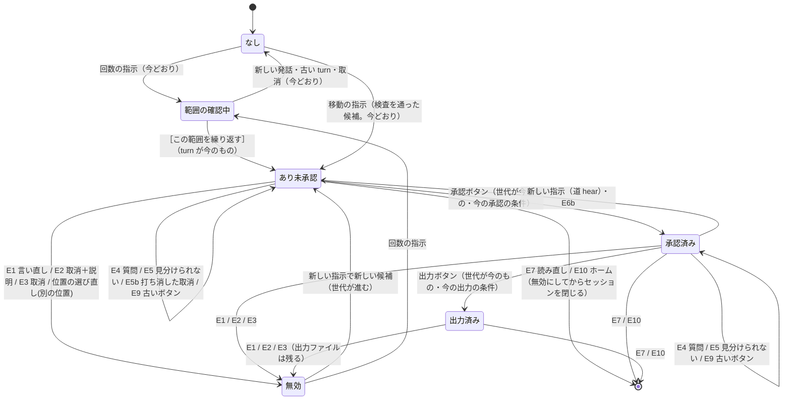
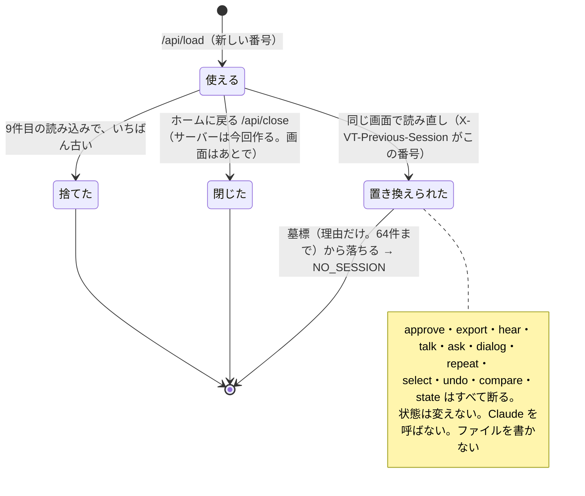
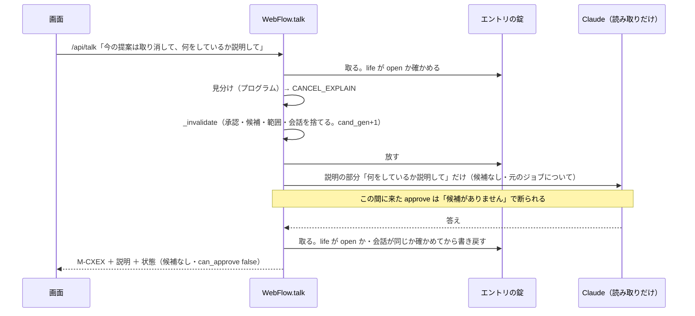

# 設計書：P0 古い変更候補が残る問題（H02 言い直し・H16 取消＋説明・ジョブの読み直し）

- 書いた人：Developer（Claude Code のサブエージェント）。2026-11-05
- ブランチ：`fix/p0-stale-candidates`（基点 `0f32435` ＝ `origin/fix/cock-p0-conversation` の先頭）。**この文書だけ。コード（`voice_teaching/` 以下）とテストは変えていない**
- 読む人：唐川さん（ロボットの専門家・発注者）、外部の独立安全レビュー担当（クロちゃん）
- 状態：**設計案**。受入テストは表だけで、まだ書いていない・実行していない。判定は QA Reviewer・Safety & Spec Reviewer と外部レビューで行う。実装は外部レビューの承認のあと
- 唐川さんの方針（2026-11-05）：
  1. H02：言い直しがあったら、前の候補を承認できなくする。そのうえで新しい内容を確かめる
  2. H16：はっきりした取消と説明の指示なら、前の候補を無効にしてから説明する
  3. 読み直し：新しいセッションに切り替える。前のセッションの承認・出力は、サーバー側で断る
  4. （追加の指示。2026-11-05、コーディネーター経由で受けた唐川さんの指示）**案4（ホームに戻る）を一緒に検討する**。ホームに戻る操作（`/api/close` と closed の印、戻ると失われる14の状態）を、上の3件と**同じ状態遷移・同じサーバーの無効化の仕組み**で扱う。画面（ロゴのボタン・確認の窓）は今回は作らず、「あとで作るもの」として書く（4-7・7-3 章）。案1・案2 は扱わない
- 最優先：**取消・訂正・JOB の読み直し・ホームに戻ったあとに、古い候補を承認・出力できない**こと
- 必須の条件（この文書では K1〜K11 の記号で呼ぶ。5-15 章の対応表で使う）

| 記号 | 条件 |
|---|---|
| K1 | 画面から消すだけでなく、**サーバー側で**前の候補が無効になる（approve・export・dialog・repeat などの API で、前の候補を承認・出力できない） |
| K2 | **ふつうの質問だけで変更候補を消さない**（取消・訂正と、質問・説明の頼みを見分ける） |
| K3 | 見分けられないときは**消さずに確かめる**（「取り消しますか？」など）。そのときも自動で承認・出力しない |
| K4 | 安全の判定・承認の条件・JOB の生成は変えない。候補を無効にする向き（止める・承認できなくする側）だけを足す |
| K5 | H02：言い直し → 前の候補を承認できなくする → 新しい内容を確かめる（すぐに新しい候補にはしない） |
| K6 | H16：はっきりした取消＋説明 → 前の候補を無効にしてから説明する |
| K7 | 読み直し：新しいセッションに切り替え、前のセッションの承認・出力をサーバー側で断る |
| K8 | 見分けはプログラムが決める。Claude に判定させない |
| K9 | 画面の文の数はプログラムが入れる。安全や距離を断定する言葉を使わない |
| K10 | ロックと競合：同時に来た要求でも、無効にしたあとの候補を承認・出力できない |
| K11 | ホームに戻る（`/api/close`）：戻ったあと、前の session_id の候補を承認・出力できない（approve・export・dialog・repeat などすべて断る）。戻ると失われる14の状態を、読み直しと同じ仕組みで捨てる（画面は今回作らない） |

- この設計書は同じ Claude が書いた。社内の QA・Safety のサブエージェントも同じ Claude で、**外部の独立レビューの代わりにはならない**
- 検査を通ること・この設計で候補を無効にできることは、**物理的な安全の保証ではない**。変更後の動きは人が確かめてから承認する

---

## 1. 3件の今の動き（基点 0f32435 で実際に呼んで確かめた）

確かめ方：作業用フォルダ（scratchpad。リポジトリの外）に一時スクリプトを置き、`WebFlow` を直接呼んだ。解釈の係は `MockInterpreter`、Claude に聞く係は `tests/test_claude_talk.py` の偽の client（答えを用意しないと呼ばれた時点で失敗する）。本物の Claude は0回。出力先 `sim.DEFAULT_OUT_DIR` は場合ごとに新しい一時フォルダ（`output/` には書いていない）。ジョブは `samples/dummy/DEMO_BUTTON_REPEAT.JBI` と `DEMO_C_PLACE.JBI` だけ。

使った一時スクリプト（リポジトリには入れていない）：
`C:\Users\Hid0250\AppData\Local\Temp\claude\902507686a100f0b\6bc1279b-dd30-4df5-bdad-061a4303e89d\scratchpad\p0stale\probe_a.py`〜`probe_e.py`

以下、「S-R」は「DEMO_BUTTON_REPEAT.JBI を読む → 『C00001からC00003の作業を2回から3回にして』 → ［この範囲を繰り返す］」で作った回数の変更候補（2回→3回、未承認、`can_approve: true`）。

### 1-1. H02：言い直しが打ち消しとして断られ、前の候補が承認できるまま残る

| 状態 | 文（`/api/talk`） | 今の結果 | そのあと |
|---|---|---|---|
| S-R | さっきの3回じゃなくて2回 | 道 `ask`。`count_refused`「「回じゃなく」という打ち消しの言葉があるため、回数の希望としては読みません…」 | 候補あり・`can_approve: true`。**approve → ok: True、export → ok: True**（出力ファイルができた） |
| S-R | 3回じゃなくて4回／3回じゃなくて4回にして／違う、4回 | 同じく `count_refused` | 候補あり・承認できる |
| S-R | やっぱり4回にして／4回にして | `explain_only`「承認待ちの変更候補があるため、今は説明だけ答えます…」 | 候補あり・承認できる |
| S-R | いや、2回のままでいい | 道 `hear`。「「いや」などの打ち消しの言葉があるため、変更しません」 | 候補あり・承認できる |
| S-R | さっきのは間違い、4回 | 道 `several`「変更は1つずつ…どれも受け付けていません」 | 候補あり・承認できる |
| S-R＋承認済み | 3回じゃなくて4回／さっきの3回じゃなくて2回 | `count_refused` | **承認も残る。`can_export: true`、export → ok: True** |
| S-R＋承認済み | 4回にして | `explain_only`（文は「承認待ちの…」で、承認済みと合っていない） | **承認が残る** |
| S-R＋出力済み | 3回じゃなくて4回 | `count_refused` | 承認・出力済みの表示が残る |

コードの場所：
- `voice_teaching/web/flow.py` 847〜880行 `_talk_route`：回数の言葉があると道 `count`（→ `ask`）になる。承認済みでも `change` が真なので 324行の分かれ道に入らず、`_begin_instruction`（承認の取り消し、1070行）を通らない
- `flow.py` 955〜957行（`ask`）：`talk.read_count` の `stop`（打ち消し）なら決まった文を返すだけ。Session（候補・承認）には触らない（`ask` は読み取りだけという約束）
- `voice_teaching/claude_talk.py` 364〜378行 `read_count`：打ち消しの言葉（`utterance.py` 247〜251行 `NEGATION_WORDS` の「じゃなく」「違う」など）があれば `stop`
- `flow.py` 958行：候補があって `looks_like_change`（`claude_talk.py` 572行）なら `PENDING_EXPLAIN_ONLY`
- 結果として、どの API にも候補を捨てる・承認を消す処理が届かない。`/api/approve`（`flow.py` 705行）は「今の候補があり、作り直したバイト列が同じ」なら通る

### 1-2. H16：取消＋説明を解決できず、前の候補が残る

| 状態 | 文 | 今の結果 | そのあと |
|---|---|---|---|
| S-R | 今の提案は取り消して、何をしているか説明して | 道 `hear`。「「取り消し」などの打ち消しの言葉があるため、変更しません」 | 候補あり・承認できる（approve → ok: True） |
| S-R | 変更は取り消して、何してるか教えて（169件の H16 の文） | 同じ | 同じ |
| S-R | 取り消して、説明して／取り消してから説明して／キャンセルして、何をしているか教えて | 聞き返し「今の変更候補を取り消しますか？ 取り消す場合は「取り消して」と言ってください」 | 候補あり・承認できる |
| S-R＋承認済み | 今の提案は取り消して、何をしているか説明して | 道 `hear` が承認だけ取り消す（「新しい指示を受け取ったため、前の承認を取り消しました。変更候補は残しています…」） | 候補が残り、**もう一度承認できる** |

コードの場所：
- `flow.py` 259〜272行（`_instruction`）：元に戻す（undo）と読めたとき、文の全体が `ut.is_explicit_cancellation`（`utterance.py` 766〜772行。文の全体が決まった形のときだけ真）なら `s.undo()`、そうでなければ「取り消しますか？」の聞き返し。説明の部分は扱わない
- 「今の提案は取り消して、…」は `utterance.py` の打ち消しの一覧の「取り消し」に当たり、`pre_check` が止める（undo の前に止まる）
- 「変更は取り消して」は `is_explicit_cancellation` の前置き（「今の提案は」「この提案を」だけ）に入っていない（確かめた：False）

### 1-3. ジョブの読み直し：前の session_id で承認・出力が通る

| 手順 | 結果 |
|---|---|
| 1. S-R（未承認）→ 同じ中身を `previous` 付きで読み直す（新しい番号 b） → **古い番号 a で approve** | **ok: True、`can_export: true`。export → ok: True（`DEMO_BUTTON_REPEAT_SIM.JBI.txt` ができた）** |
| 2. S-R → 承認 → 読み直し → 古い番号で export | **ok: True** |
| 3. 範囲の確認中に読み直し → 古い番号で `/api/repeat`（yes・古い turn） | **候補ができた（`candidate_made: true`、`can_approve: true`）** |
| 4. 読み直し → 古い番号で hear・talk・select・state・ask(sync) | すべて ok: True（古いセッションが動き続ける） |
| 5. DEMO_C_PLACE で C00003 を Y−10mm の候補 → **別のジョブ**（DEMO_BUTTON_REPEAT）を読む → 古い番号で approve・export | どちらも ok: True |
| 6. 会話の位置の確かめ中（「置くところを少し手前にして」）→ 読み直し → 古い番号・古い turn で `/api/dialog` | 会話が進む（「どちらの方向…に、何mm動かしますか？」） |
| 7. 読み直しを8回 → 古い番号で approve | 8件を超えると捨てられて NO_SESSION。**ただし古いタブが途中で古い番号の state を読むと、`_run` が `move_to_end` するため捨てられず、8回のあとも approve → ok: True** |

コードの場所：
- `flow.py` 168〜194行 `load`：`previous` は「人が教えた意味」を引き継ぐためだけに読む（183〜188行）。前のエントリを消さない・印も付けない。`MAX_SESSIONS`（8）を超えたときだけ古いものから捨てる（192〜193行）
- `flow.py` 1024〜1037行 `_run`：番号でエントリを探し、見つかれば `move_to_end`（使うたびに捨てられる順番の後ろへ）。エントリが「使ってよい状態か」は見ない
- `voice_teaching/web/server.py` 140〜147行：`X-VT-Previous-Session` の見出しを `load(previous=…)` に渡すだけ。178〜179行：`/api/approve`・`/api/export` は session_id と承認者の名前だけで呼ぶ（どの候補を承認するかの印が無い）
- `web/static/app.js` 121〜123行 `previousHeader`、144〜163行 `applyLoad`：画面は読み込みのたびに `state.sessionId` を新しい番号に置き換える（読み込みに失敗しても null にする）。画面からは古い番号を送らないが、サーバーは古い番号を断らない

### 1-4. ほかに見つけたこと（設計に入れる）
- 範囲の確認中の質問（「何をしている？」）は道 `hear` に入り、`Session.hear` の 145行 `forget_range` で範囲の確認が消える（止める側。今回は変えない。8章 Q-9）
- 候補ありの「何をしている？」「説明して」は道 `ask`（Claude）に行き、候補は残る（今も K2 を満たす）
- 候補ありの「取り消すとどうなる？」「キャンセルってどうやるの？」「取り消したほうがいい？」は、知らない言葉の聞き返しになり、候補は残る（消えないが、答えにもなっていない）
- 候補ありの「もう一回前後を比べて」（H12）は、「もう一回」を回数として読み、道 `several` になる（`read_count` は「1回でよいですか？」と読む）。見分けでは「もう一回」を回数の値にしない（3-3 章）
- 既存のテスト `tests/test_claude_talk.py` の `test_e5_data_change_separates_conversation`（655〜665行）は、読み直しのあとに**古い番号**で `ask(sync=True)` を呼び、知らせが出ることを確かめている。この設計では古い番号は断るので、このテストの期待は変わる（6-2 章）

---

## 2. 状態と状態遷移

### 2-1. 状態の定義（サーバーのメモリの中。プログラムが持つ）

**候補の状態**（1つのセッションに1つ）

| 状態 | 今のコードでの見分け方 | 新しく持つもの |
|---|---|---|
| なし | `Session.candidate is None` で、無効の記録も無い | — |
| あり（未承認） | `candidate` あり・`_approved(e)` が偽 | 候補の世代 `cand_gen`（整数） |
| 承認済み | `_approved(e)` が真・`exported is None` | 承認したときの世代 `approval_gen` |
| 出力済み | `_approved(e)` が真・`exported` あり | 同上 |
| 無効 | — | `voided`（無効にした世代・理由・プログラムが作った要約）。候補は捨ててある。次に新しい候補を作るまで残す（断り文と状態の1行に使う） |

**範囲の確認**：なし／確認中（`Session.repeat_range`、番号 `turn`）。候補と同時には無い（候補があると `_hear_repeat`・`confirm_repeat` が断る）。

**会話の確認待ち**（どれも番号つき、または答え待ちの印）

| 種類 | 場所 | 古い押下を断る今の仕組み |
|---|---|---|
| 位置の確かめ・方向と量（会話） | `_Entry.dialog`（`step`・`turn`） | `choose` が turn と id を照らす（`flow.py` 558〜585行） |
| 聞き返しの答え待ち・上下の案内の続き | `Session._awaiting_answer`・`_updown_followup` | `forget_question` で捨てる |
| 「どの動きのことですか？」 | `_Entry.talk.pending`（`token`） | `TalkMemory.choose` が token を照らす。候補が変わると `sync` が捨てる（`claude_talk.py` 723〜735行） |
| 指示の道の選択肢（［変更したい］など） | 画面の `showReply` の中だけ。押すと文を `/api/hear` に送る | 番号は無い（文そのものを送る。9章） |

**セッションの状態**（新しく `_Entry.life` に持つ）

| 状態 | 意味 | 古い番号の要求への答え |
|---|---|---|
| 使える（open） | 今の画面の番号 | 今どおり |
| 置き換えられた（replaced） | 同じ画面で別の（同じ）ジョブを読み直した（`X-VT-Previous-Session` で指名された） | すべて断る（理由：読み直し） |
| 閉じた（closed） | ホームに戻った（案4 の `/api/close`。**サーバーの API は今回作る**。画面のロゴのボタン・確認の窓はあとで作る） | すべて断る（理由：閉じた） |
| 捨てた（evicted） | 8件を超えて古いものから捨てた | すべて断る（今の `NO_SESSION` の文） |

### 2-2. 出来事と遷移の表（候補あり＝未承認・承認済み・出力済みのどれか）

「無効にする」＝ 4-2 章の `_invalidate`：承認を消す・候補を捨てる・範囲の確認を捨てる・会話を終える・答え待ちを捨てる・`cand_gen` を1つ進める・`voided` を書く。元の JOB とディスクの出力ファイルには触らない。

| 出来事（3章の見分けの結果） | なし | あり（未承認） | 承認済み | 出力済み | 範囲の確認中 | Claude | 返す文 |
|---|---|---|---|---|---|---|---|
| E1 言い直し（H02。`CORRECTION`） | 今のまま（B06 などの今の動き。変えない） | **→ 無効** | **→ 無効**（承認も消す） | **→ 無効**（ファイルは残る） | 今のまま（`hear` が範囲の確認を捨てる） | 呼ばない | M-CORR（新しい内容は確かめるだけ。新しい候補・範囲は作らない） |
| E2 取消＋説明（H16。`CANCEL_EXPLAIN`） | 今のまま | **→ 無効 → 説明** | **→ 無効 → 説明** | **→ 無効 → 説明** | 今のまま | 説明の部分だけを1回（読み取りだけ） | M-CXEX ＋ Claude の説明 |
| E3 取消だけ（`CANCEL`） | 今のまま（「元に戻す変更候補はありません」） | **→ 無効** | **→ 無効** | **→ 無効** | → なし（今どおり） | 呼ばない | 今の文のまま（`APPROVAL_AND_CANDIDATE_CANCELLED` など） |
| E4 ふつうの質問（`QUESTION`） | 今のまま | **そのまま**（候補・世代を変えない） | **そのまま**（承認も残す。今の `_talk_route` 324〜327行） | そのまま | 今のまま（範囲は消える。Q-9） | 今どおり（説明の道） | 今どおり |
| E4b 取消のしかたを聞く問い（`QUESTION_ABOUT_CANCEL`） | 今のまま | そのまま | そのまま | そのまま | 今のまま | 呼ばない | M-HOWCX（決まった文） |
| E5 見分けられない文（`UNSURE`） | 今のまま | **そのまま** | **そのまま**（承認は消さない・進めない） | そのまま | 今のまま | 呼ばない | M-UNSURE（「取り消しますか？」） |
| E5b 取消の打ち消し（`KEEP`。「取り消さないで」） | 今のまま | そのまま（今どおり） | そのまま（今どおり） | そのまま | 今のまま | 今どおり | 今どおり |
| E6 新しい指示（印なし。`OTHER`） | 今どおり（候補・範囲を作れる） | そのまま。移動・速度は今どおり `pending_reply` で断る | 今どおり。道 `hear` なら承認を消して → あり（未承認） | 同左 | 今どおり（範囲を捨てて読み直す） | 今どおり | 今どおり |
| E6b 同じ種類の新しい値だけ（「4回にして」。`SAME_KIND_VALUE`） | 今どおり | そのまま（候補を消さない）＋確かめる | **承認を消して → あり（未承認）**＋確かめる（Q-3） | 同左 | 今どおり | 呼ばない | M-SAME |
| E7 ジョブの読み直し（`load(previous=前の番号)`） | 前のセッション → 置き換えられた | 前：→ 無効・置き換えられた | 前：→ 無効・置き換えられた | 前：→ 無効・置き換えられた（ファイルは残る） | 前：範囲を捨てる・置き換えられた | 呼ばない（呼んでいる途中の答えは書き戻さない） | 新しい画面に M-RELOAD（任意。Q-6） |
| E10 ホームに戻る（`/api/close`。画面の確認の窓で［作業を捨てて戻る］を押したあと。画面はあとで作る） | セッション → 閉じた | → 無効・閉じた | → 無効・閉じた（承認も消す） | → 無効・閉じた（ファイルは残る） | 範囲を捨てる・閉じた | 呼ばない（呼んでいる途中の答えは書き戻さない） | `{ok: true, closed: true, lost: [...]}`。2回目は M-OLDSID（閉じた） |
| E8 古い session_id での各 API | — | — | — | — | — | 呼ばない | M-OLDSID。**状態は何も変えない** |
| E9 古い turn・古い候補の世代のボタン | 今どおり断る | 断る。候補・承認はそのまま（今の `choose`・`confirm_repeat` は範囲の確認を捨てる。止める側なので残す） | 断る（承認は消さない） | 断る | 断る（範囲の確認を捨てる。今どおり） | 呼ばない | 今の文（`dg.STALE`・`rc.RANGE_STALE`・`STALE_CHOICE`）か M-STALEGEN |

無効のあと（候補の状態「無効」）からの出来事：
- E1〜E5・E8・E9：候補が無いので「なし」と同じ扱い（無効のまま）。approve・export は「承認する変更候補がありません」に無効の理由を添えて断る（M-VOIDED）
- 新しい指示で新しい候補を作る → あり（未承認）。`cand_gen` が進み、`voided` を消す
- E7 → 置き換えられた／E10 → 閉じた

E7（読み直し）と E10（ホームに戻る）の違いは2つだけ：E7 は新しいセッションを作り、同じ中身なら「人が教えた意味」だけを写す。E10 は新しいセッションを作らず、意味も捨てる。前のセッションを無効にする手順（4-2 の `_end`）は同じ関数。

### 2-3. 図（候補の状態）

### 2-4. 図（セッションの状態）

### 2-5. 1つの要求の中の順番（取消＋説明）

---

## 3. 取消・訂正と質問の見分け方（プログラムで決める）

### 3-1. 原則
- 見分けるのは**プログラムの決まった規則**（正規表現と言葉の一覧）。Claude には判定させない。今回は補助としても使わない（K8）
- 見分けを使うのは、**候補があるとき（あり・承認済み・出力済み）だけ**。候補が無いときと範囲の確認中は、今の動きのまま（変える所を小さくするため。B06 など169件の結果を変えない）
- 見分けの結果で**新しくできること**は、候補を無効にすること（止める側）と、決まった文を返すことだけ。候補・範囲・承認を新しく作る道は足さない（K4）
- 規則は上から順に当て、最初に当てはまったものに決める。どれにも当てはまらなければ今の道（`OTHER`）
- 迷う形（ためらい・推量・条件・疑問・読めない残り）は、無効にしないで確かめる（K3）

### 3-2. 前処理
1. NFKC で正規化し、全角の数字を半角にする（`rc.to_digits`）。カタカナはひらがなに寄せて比べる（`utterance._fold_kana`。「キャンセル」「ヤメて」）
2. 節に分ける：`、` `,` `。` `.` `！` `!` と、つなぎ「てから」「それから」「そして」「あと、」（読点つきの「あと」だけ。「あと3mm」は分けない）。取消の動詞のて形のすぐあとに文が続くときも分ける（「取り消して説明して」→「取り消して」「説明して」）
3. 言い直しの印（3-3 の M）の前後で、前の部分（A）と後の部分（B）に分ける（「3回じゃなくて4回」→ A「3回」、B「4回」）

### 3-3. 言葉の一覧（初めの案。足す・外すは唐川さんの確認：Q-1）

| 記号 | 名前 | 言葉（ひらがなに寄せて比べる） |
|---|---|---|
| X | 取消の明示の節（節の全体が一致） | 今の `is_explicit_cancellation`（「取り消して」「取り消します」「取消して」「キャンセル（して）」「元に戻して」「元に戻します」「もとに戻して」「やめて」「やっぱり／やはり／じゃあ／では＋それら」「さっきのを戻して」「今の提案は／この提案を＋それら」＋「ください」）に、**前置きだけを足す**：「(今の｜この｜さっきの｜前の)?(提案｜変更｜変更候補｜候補)(は｜を)」「さっきのは」「今のは」 |
| N | 取消の打ち消し | 「取り消さない」「取り消さずに」「キャンセルしない（で）」「戻さない」「戻さずに」「やめないで」「やめずに」「（キャンセル｜取り消し｜元に戻すの）はやめて」（今の `undo_negations` と `_plain_undo` の「は」の形） |
| M | 言い直しの印 | 「じゃなくて」「じゃなく」「ではなくて」「ではなく」「でなくて」「でなく」「じゃない、」「違う、」「ちがう、」「違います、」「いや、」「やっぱり」「やはり」「間違い」「間違えた」「訂正」「言い直し」「に変えて」「に変更して」「に直して」 |
| V | 新しい値（B の部分か、X 以外の節にあるもの） | 回数（`read_count` が読めた整数、または `stop` になった小数・負の数・あいまいな回数）・「N回のまま」・量（mm・ミリ・%）・軸と符号（「Yプラス」「プラス」）・位置番号（C と5桁）。**「もう一回」「もう1回」「もう一度」「もういちど」「一回（見せ｜比べ｜説明）」は値にしない**（副詞） |
| H | ためらい・推量・条件・疑問 | 「かも」「かな」「迷」「たぶん」「多分」「おそらく」「と思う」「気がする」「ほうがいい」「方がいい」「べき」「もし」「なら」「たら」「れば」「場合」「とか」「かどうか」「？」「?」、文の終わりの「か」「の」「ですか」「ますか」 |
| HQ | 取消のしかた・結果を聞く問い | 「どうやって」「どうやる」「どうなる」「どうすれば」「方法」「やり方」「とは」「って何」「し方」 |
| E | 説明の頼みの節（白い一覧。節の全体が一致） | `^(?:(今｜この｜元の｜読み込んだ)?(ジョブ｜動作データ｜ロボット｜動き｜作業)?(は｜が｜で)?)?(何(を)?(して(い)?る｜する)(の｜のか｜か)?(を)?)?(説明して｜教えて｜説明｜説明だけ｜聞きたい｜知りたい)(ください｜ほしい｜欲しい)?$`、`^何(を)?(して(い)?る｜する)(の)?[?？]?$`、`^(どういう｜どんな)(動き｜作業)(か｜なのか)?(を)?(教えて｜説明して)(ください)?$`。**回数・量・軸・位置番号・承認などの言葉が入る節は E にしない** |
| B | ボタンだけの言葉 | 今の `_BUTTON_ONLY_WORDS`（承認・出力・書き出・転送・送信・保存・起動・実行・スタート・エクスポート・ダウンロード・登録・上書き・確定） |
| R | 指す言葉・つなぎ（「中身が無い」の判定に使う） | 「今の」「さっきの」「この」「その」「提案」「変更」「候補」「範囲」「は」「が」「の」「です」「だよ」「よ」「ね」「って」 |

### 3-4. 判定の順番（候補があるときだけ）

| 順 | 条件 | 結果 | 扱い |
|---|---|---|---|
| 1 | B がある、かつ X・M・取消の動詞のどれかもある（「取り消して承認して」「4回にして出力して」） | `UNSURE` | 矛盾する頼み。何も変えずに確かめる |
| 2 | B がある（ほかは無い） | `OTHER` | 今の道（button）。状態を変えない |
| 3 | N がある（「取り消さないで」「キャンセルはやめて」「やめないでそのまま」） | `KEEP` | 今の道のまま（候補・承認を変えない） |
| 4 | 取消の動詞か M を含む節に H がある | HQ もあれば `QUESTION_ABOUT_CANCEL`、無ければ `UNSURE` | 変えない |
| 5 | X の節がある | ほかの節が無い → `CANCEL`／ほかの節が全部 E → `CANCEL_EXPLAIN`／ほかの節に V → `CORRECTION`／ほか（読めない節が残る）→ `UNSURE` | 5-1〜5-3 は無効にする |
| 6 | M があり、B の部分（印より後ろ）に V がある | `CORRECTION` | 無効にする |
| 7 | M があり、印の前後から R を除くと何も残らない（「違う」「今の提案は違う」「やっぱり」「いや、」） | `UNSURE` | 変えない |
| 8 | M があり、B の部分に V ではない言葉がある（「ボタンじゃなくてスイッチを押している」） | `OTHER` | 今の道（意味を教える流れなど） |
| 9 | 候補と同じ種類の V だけで、M も取消も無い（回数の候補に「4回にして」、移動の候補に「5mmにして」）。値がきれいに読めたときだけ（`read_count` の `stop` があれば今の道） | `SAME_KIND_VALUE` | 候補は消さない。承認済みなら承認を消す（Q-3）。確かめる |
| 10 | 疑問の言葉（`_QUESTION_WORDS`・H の疑問）や E の節がある | `QUESTION` | 今の道（説明。候補・承認を変えない） |
| 11 | ほか | `OTHER` | 今の道 |

### 3-5. 例（候補 S-R ＝ 2回→3回 があるとき）

| 文 | 規則 | 結果 |
|---|---|---|
| さっきの3回じゃなくて2回 | 6（M「じゃなくて」、B「2回」） | CORRECTION（新しい値 2 ＝ 今の回数。M-CORR で「今2回のまま」と知らせる） |
| 3回じゃなくて4回／3回じゃなくて4回にして／3回ではなく4回／3回でなく4回 | 6 | CORRECTION（4） |
| 違う、4回／違う違う、4回にして／いや、4回 | 6 | CORRECTION（4） |
| やっぱり4回／やっぱり4回にして | 6 | CORRECTION（4） |
| さっきのは間違い、4回 | 6 | CORRECTION（4） |
| 4回に変えて／4回に直して／4回に変更して | 6 | CORRECTION（4） |
| いや、2回のままでいい | 6（B「2回のまま」） | CORRECTION（のまま。今2回） |
| 取り消して、4回にして | 5（X＋V） | CORRECTION（4） |
| 3回じゃなくて2.5回 | 6（V は小数） | CORRECTION（無効にしたうえで「回数は整数で…」の今の文） |
| 5回じゃなくて4回（候補は 2→3） | 6 | CORRECTION（前の候補の記録「2回→3回」を M-CORR に出す） |
| C00002じゃなくてC00003 | 6（V は位置番号） | CORRECTION（無効。新しい内容は言い直してもらう） |
| 3回じゃなくて4回？ | 4（M の節に「？」） | UNSURE |
| 3回じゃなくて4回かな／4回のほうがいいかな | 4 | UNSURE |
| 今の提案は取り消して、何をしているか説明して | 5（X＋E） | CANCEL_EXPLAIN |
| 変更は取り消して、何してるか教えて（169件の H16） | 5（X に足した前置き「変更は」＋E） | CANCEL_EXPLAIN |
| 取り消して、説明して／取り消してから説明して／取り消して説明して | 5 | CANCEL_EXPLAIN |
| キャンセルして、何をしているか教えて／元に戻して、どういう動きか教えて | 5 | CANCEL_EXPLAIN |
| 何をしているか説明して、それから取り消して | 5（順番は問わない） | CANCEL_EXPLAIN |
| 取り消して、3回にした理由を説明して | 5（説明の節に「3回」→ E にしない・V でもない読めない残り） | UNSURE |
| 取り消すかもしれないけど説明して | 4 | UNSURE |
| 取り消さずに説明して | 3 | KEEP（今の道。説明だけ） |
| 取り消して／今の提案は取り消して／キャンセル／元に戻して／やっぱりやめて／さっきのを戻して | 5 | CANCEL |
| 変更は取り消して／今の候補を取り消して／さっきのは取り消して | 5（前置きを足した形） | CANCEL |
| 取り消して？ | 4 | UNSURE |
| キャンセルかな／多分キャンセル／取り消すか迷っている／取り消したほうがいい？ | 4 | UNSURE |
| 取り消すとどうなる？／キャンセルってどうやるの？／取り消し方を教えて／元に戻すとどうなるの？ | 4（HQ） | QUESTION_ABOUT_CANCEL |
| 違う／今の提案は違う／やっぱり／いや、 | 7 | UNSURE |
| やっぱりいいや／もういいです／なしで／やめとこうかな／違うかも | 4 または 7（「いいや」「なしで」は一覧に無い → 11 の OTHER になるものは、今の動きを確かめて UNSURE に入れるか決める。Q-1） | UNSURE（案） |
| 3回はやめて | 3 ではない（「は＋やめて」は N の形だが対象が回数）→ 4/7 で決まらない → 案：UNSURE | UNSURE（Q-1） |
| 取り消さないで／キャンセルはやめて／元に戻すのはやめて／やめないでそのまま | 3 | KEEP |
| 取り消して承認して／取り消して出力して | 1 | UNSURE |
| 今の提案のまま承認して／承認して／実機にジョブを送って | 2 | OTHER（今の button の道） |
| 4回にして（印なし） | 9 | SAME_KIND_VALUE |
| 3回くらいにして | 9 の除外（`read_count` の `stop`） | OTHER（今の「3回でよいですか？」） |
| もう一回前後を比べて／変更前をもう一度見せて | 10・11（「もう一回」「もう一度」は値にしない） | QUESTION／OTHER（今の道） |
| 何をしている？／説明して／説明だけ聞きたい／これは何の動き？／どこが変わるの？／なぜ3回なの？ | 10 | QUESTION |
| 今の候補は何回？／何回から何回にする提案なの？／3回にするとどうなる？／さっきの3回って何？ | 10（疑問。M も取消も無い） | QUESTION（「3回」は値として扱わない：M が無いので 6 に入らない） |
| ボタンじゃなくてスイッチを押している | 8 | OTHER（意味を教える今の流れ） |
| C00002をZプラス3mm（回数の候補があるとき） | 11 | OTHER（今どおり「承認待ちの変更候補があります…」で断る） |

移動の候補（「S-M」＝ DEMO_C_PLACE で C00003 を Y −10mm）のとき：
| 文 | 結果 |
|---|---|
| 10mmじゃなくて5mm／Yマイナスじゃなくてプラス／やっぱり5ミリ | CORRECTION（無効。新しい内容は位置・方向・量をそろえて言い直してもらう。**前の候補の軸・符号・量を新しい内容に借りない**） |
| 5mmにして | SAME_KIND_VALUE |
| どこに動くの？／C00003はどこ？ | QUESTION |

### 3-6. 見分けの結果ごとの処理

| 結果 | 処理（すべてエントリの錠の中。Claude を呼ぶときだけ錠の外） |
|---|---|
| CORRECTION | `_invalidate(e, "言い直し")` → M-CORR を返す。新しい候補・範囲は作らない。Claude は呼ばない。新しい内容は、人が言い直した文を今の道（回数なら Claude の照合と範囲のボタン、移動なら検査）で通す（Q-2 の案A） |
| CANCEL_EXPLAIN | `_invalidate(e, "取消")` → 錠を放す → `ask` に**説明の節だけ**を渡す（取消の節は Claude に送らない。Claude が「取り消しました」と状態を言う文を作らないため）→ M-CXEX ＋ 説明 |
| CANCEL | `_invalidate(e, "取消")`。返す文は今の文のまま（`Session.undo` の文・`APPROVAL_AND_CANDIDATE_CANCELLED`）。169件の H01・H04〜H06・H15 の結果を変えないため |
| QUESTION | 今の道。候補・承認・世代を変えない |
| QUESTION_ABOUT_CANCEL | M-HOWCX を返す。何も変えない |
| UNSURE | M-UNSURE を返す。何も変えない（承認も消さない・進めない）。Claude は呼ばない |
| KEEP・OTHER | 今の道 |
| SAME_KIND_VALUE | 候補はそのまま。承認済みなら `_cancel_approval`（今の「新しい指示で承認を取り消す」と同じ向き）。M-SAME を返す。Claude は呼ばない |

見分けを入れる場所：`WebFlow.talk` の振り分け（`_talk_route` の前、同じ錠の中）。`/api/hear` に画面の選択肢の文が来たとき（`answerChoice`）も、同じ関数を通す（決まった文なので、ふつうは `OTHER`）。`/api/ask` に文が来たとき（画面からは来ない。explain.js は文を `/api/talk` へ送る）は、`ask` は読み取りだけの約束なので無効にはせず、CORRECTION・CANCEL・CANCEL_EXPLAIN・UNSURE なら M-ASKONLY を返して Claude を呼ばない（候補は残る。8章 R-4）。

---

## 4. サーバー側の無効化の仕組み

### 4-1. 新しく持つもの（すべてメモリの中だけ。ディスク・records/ に書かない）

| 場所 | 名前 | 中身 |
|---|---|---|
| `_Entry` | `life` | `"open"`／`"replaced"`／`"closed"`／`"evicted"` |
| `_Entry` | `cand_gen` | 候補の世代（整数）。候補ができた・捨てた・無効にしたたびに1つ進める。`_run` などの最後に「`Session.candidate` が前に見たものと同じもの（`is`）か」を見て、違えば進める（どの道で変わっても漏れない） |
| `_Entry` | `approval_gen` | 承認したときの `cand_gen` |
| `_Entry` | `voided` | 最後に無効にした記録 `{gen, why, summary, had_approval, exported_name}`。数・位置は候補の比較（`Comparison`）からプログラムが作る。新しい候補ができたら消す |
| `WebFlow` | `_ended` | 墓標：`OrderedDict[番号, 理由]`。64件まで。ジョブの中身・候補は入れない |
| 状態（`_state`） | `candidate_gen`・`voided`・`life` | 画面へ返す（`voided` は要約の文だけ） |

### 4-2. 内部の関数

- `_invalidate(e, why) -> list[str]`（錠の中で呼ぶ）：
  1. `voided` を書く（候補の要約・承認していたか・出力したファイル名）
  2. `_cancel_approval(e, why)`（今の関数。承認・`sim_proposal`・`approved_candidate`・`approval_updown` を消す）
  3. `e.session.undo()`（今の関数。`forget_question`・`forget_range`・`_discard`）
  4. `e.dialog.end()`、`e.dialog.estimated = None`、`e.comparison = None`、`e.exported = None`
  5. `cand_gen += 1`
  6. 作業ログに1行（「{why}のため、変更候補を取り消しました（{要約}）」）
  7. 捨てたものの短い名前の並びを返す（案4 の `home_loses` と同じ名前を使う）
- `_end(sid, life)`：`self._lock` の中でエントリを `_entries` から外し、`e.life = life` を立て、墓標に書く。錠を放してから `e.lock` を取り、`_invalidate(e, 理由)` と `e.explain = None`・`e.talk.pending = None` を行う。**`self._lock` を持ったまま `e.lock` を取らない**（今の `_run` と同じ順番：先に `self._lock`、放してから `e.lock`）
- `_lookup(sid)`：`_entries` に無ければ墓標を見て、理由に合う断りを返す。墓標にも無ければ今の `NO_SESSION`
- `load(data, previous)`：
  1. `previous` が今の番号なら、まずその**意味だけ**を写す（`prev.lock` の中で `content_hash` と `meanings` の写し）
  2. `_end(previous, "replaced")`（**新しいジョブが読めなくても閉じる**。画面は読み込みのたびに前の番号を捨てるため：`app.js` 145行。Q-5）
  3. 新しいジョブを読む。読めたら、同じ中身のときだけ意味を入れる（今の 186〜188行と同じ条件。`recheck` も同じ）
  4. 新しい番号を登録。9件目を超えたら古いものを `_end(…, "evicted")`
  - 引き継がないもの：候補・承認・出力・範囲の確認・会話・答え待ち・「どの動きのことですか？」・Claude に聞いた会話・選んでいる位置・作業ログ
- `close(sid)`（ホームに戻る。`/api/close`。**今回作る**）：
  1. `_lookup(sid)` で見つからない・`life != "open"` なら `{ok: false, error: M-OLDSID, session_closed: {...}}`（2回目の close も同じ。状態は変えない）
  2. `_end(sid, "closed")`。読み直しと同じ関数で、候補・承認・出力の記録・範囲の確認・会話・答え待ち・「どの動きのことですか？」・Claude に聞いた会話を捨てる。**人が教えた意味も捨てる**（読み直しとの違い）
  3. `{ok: true, closed: true, lost: [...]}` を返す（`lost` は `_invalidate` が返した名前の並び。4-7 の表の名前）。新しいセッションは作らない
  4. 声・文字（`/api/talk`・`/api/hear`）からは呼ばない。「ホームに戻って」と言っても閉じない（今の道で読む）。呼ぶのは画面のボタンだけ（あとで作る）
- 状態（`_state`）に `home_loses`（4-7 の 1〜11 のうち、今あるものの名前の並び。プログラムが決める）を足す。今回は画面で使わない（あとで作る確認の窓が使う）

### 4-3. 各 API での扱い

共通：`_lookup` で見つからない・`life != "open"` なら、**状態を変えずに**断る。答えの形 `{"ok": false, "error": M-OLDSID, "session_closed": {"reason": "replaced"}}`（`state` は返さない）。Claude を呼ばない・ファイルを書かない。エントリを見つけたあと錠を待つ間に閉じられることがあるので、**錠を取ったあとにもう一度 `life` を見る**（`_run`・`talk`・`ask` の全部）。

| API | 古い・閉じた番号 | 使える番号で、候補が無効のあと | 古い世代・古い turn |
|---|---|---|---|
| `/api/approve` | 断る | 「承認する変更候補がありません」＋ M-VOIDED | 送られた `candidate_gen` が今の `cand_gen` と違えば M-STALEGEN で断る（承認しない・候補は変えない） |
| `/api/export` | 断る | 今の `NOT_APPROVED`＋ M-VOIDED | `candidate_gen` が `approval_gen`・`cand_gen` と違えば断る |
| `/api/dialog`（choose） | 断る | 会話は終えてあるので `dg.STALE`（今どおり） | 今どおり `dg.STALE` |
| `/api/repeat` | 断る | 範囲の確認は捨ててあるので `rc.RANGE_STALE`（今どおり） | 今どおり |
| `/api/select`・`/api/undo`・`/api/compare` | 断る | 今どおり | — |
| `/api/hear` | 断る | 今どおり（新しい指示として読む） | 選択肢の文には番号が無い（9章 R-3） |
| `/api/talk` | 断る（入口で。`hear`・`ask` にも行かない） | 3章の見分け → 今の道 | — |
| `/api/ask`（文・choose・sync・info・reset） | 断る。**Claude を呼んでいる間に閉じられたら、答えを書き戻さず断る**（`last_evidence` も書かない） | 今どおり（読み取りだけ） | choose の token は今どおり（候補が変わると `sync` が捨てる） |
| `/api/state` | 断る（**古いタブが読んでも、捨てる順番の後ろに回さない**。1-3 の 7） | 今どおり | — |
| `/api/load`・`/api/sample` | — | 4-2 の手順 | — |
| `/api/close`（ホーム） | 断る（2回目も同じ） | 4-2 の `close`。無効にしてから閉じる | — |

`candidate_gen` の扱い（Q-4）：
- 画面（`app.js` の承認・出力のボタン）は、表示中の状態の `candidate_gen` を必ず送る
- HTTP（`server.py`）では**必須**にする案：無い・整数でない → 「画面の変更候補の番号がないため、承認できません」で断る。今 `/api/approve` を直接呼ぶ既存テスト（20か所ほど）は番号を足す（緩める変更ではない）
- Python の `WebFlow.approve(sid, approver, candidate_gen=省略)` は、省略なら今の動き（テストの書き換えを減らすため）。省略しても `life` と候補の有無の検査は必ず通る
- 承認の条件そのもの（作り直したバイト列が同じ・上下の向きの照合が同じ・実機用の検査で止まった候補は承認しない など）は**変えない**。世代の照合は、その前に足す断りの条件（止める側）

### 4-4. 古いタブからの要求
- 同じタブで読み直した：前の番号は「置き換えられた」。そのタブは新しい番号だけを使う。前の番号の要求（遅れて届いた応答待ちのもの・別の道具からのもの）は全部断る
- 別のタブ（`X-VT-Previous-Session` を送らない読み込み）：**今回は前のタブを閉じない**（2つのタブはそれぞれ自分の画面の候補を持つ。画面に出ている候補なので「見えない古い候補」ではない）。1つのサーバーで使える画面を1つだけにする案は Q-7
- ブラウザーの再読み込み（F5）：画面の番号はメモリだけなので消え、前の番号は誰も持たないまま「使える」で残り、8件を超えると捨てられる（R-2）
- 画面は、`session_closed` の答えが来たら、その答えの文を出し、操作のボタンを使えないようにする（今の `res.error` の表示で足りる。見た目は変えない）

### 4-5. ロックと競合（同時に来たとき）

| 同時に来たもの | 決まり | 結果 |
|---|---|---|
| 古い番号の approve と、読み直し | `_end` は先に `self._lock` の中で `_entries` から外し `life` を立てる。approve は錠を取ったあとに `life` を見る | approve が先に錠を取っていれば承認できるが、すぐあとの `_invalidate` で消える。読み直しが返ったあとは、古い番号で承認も出力もできない |
| 古い番号の export と、読み直し | 同上。export は錠を持ったままファイルを書く | 読み直しより前に錠を取った出力は書かれる（承認ボタンのあとの出力ボタンの操作で、読み直しの前に届いたもの）。読み直しが返ったあとの出力は0件。R-5 |
| 取消＋説明（Claude を呼んでいる間）と approve | 無効にしてから錠を放して Claude を呼ぶ | approve は「候補がありません」で断られる |
| Claude に聞いている間に読み直し | `ask` は答えが返ったら錠を取り、`life` と会話（`e.explain is conv`）を確かめる | 答えを書き戻さない。`session_closed` を返す |
| 言い直しと、古い世代の approve | 錠で順番が決まる | 言い直しが先：approve は世代違い・候補なしで断る。approve が先：承認されるが、言い直しの `_invalidate` で消える |
| 言い直し2つ | 錠で順番が決まる | 1つ目で無効。2つ目は候補が無いので「なし」の扱い（今の動き） |
| 範囲のボタン（古い turn）と、取消 | 錠で順番が決まる | どちらの順でも候補は残らないか、取消のあとに作られない（`confirm_repeat` は turn を照らす） |
| ホームに戻る（close）と approve・export・Claude に聞く | 読み直しと同じ（`_end` を使う） | close が返ったあと、古い番号で承認・出力は0件。Claude の答えは書き戻さない |
| close を2つ同時に | `self._lock` の中で外すのは1回だけ | 1つ目が ok、2つ目は M-OLDSID |
| `self._lock` と `e.lock` | 片方を持ったまま、もう片方を取らない（4-2） | デッドロックしない（5-12 の CC-07 で確かめる） |

### 4-6. 画面が出す文（数・位置・名前はプログラムが入れる。`{}` は空欄。断定の言葉を使わない）

| 記号 | 文（案） |
|---|---|
| M-CORR | 「言い直しを受け取ったため、前の変更候補（{要約}）を取り消しました。承認・出力はできません。元の動作データは変わっていません。」＋ 回数で新しい値が読めたとき「{n}回にする場合は、「{n}回にして」と言い直してください。まだ新しい変更候補は作っていません」／新しい値が今の回数と同じとき「動作データでは今{cur}回です。{cur}回のままなら、変更はありません」／回数が整数でないとき今の文「回数は整数で言ってください…」／移動・位置のとき「新しい内容は、位置・方向・量（mm）をそろえて、もう一度指示してください。まだ新しい変更候補は作っていません」 |
| 承認していたとき足す | 「前の承認も取り消しました。」 |
| 出力していたとき足す | 「出力したファイル（{ファイル名}）は、そのまま残っています（実機には入れないでください）。」 |
| M-CXEX | 「前の変更候補（{要約}）を取り消しました。元の動作データは変わっていません。続けて、読み込んだ元の動作データについて答えます」（＋承認・出力のときの文） |
| M-HOWCX | 「取り消す場合は、［元に戻す］を押すか「取り消して」と言ってください。取り消しても元の動作データは変わりません。今の変更候補はそのままです」 |
| M-UNSURE | 「今の変更候補（{要約}）を取り消しますか？ 取り消す場合は、［元に戻す］を押すか「取り消して」と言ってください。候補と承認の状態は変えていません」（今の `flow.py` 271行の文に要約と最後の1文を足したもの） |
| M-SAME | 「今の変更候補（{要約}）があります。{n}回に言い直す場合は、先に「取り消して」と言ってから、もう一度指示してください。候補はそのままです」（承認していたら「前の承認を取り消しました。」を頭に） |
| M-OLDSID（読み直し） | 「この画面の番号は、ジョブを読み直したため使えません。この番号の変更候補・承認・出力は受け付けません。新しく読み込んだ画面で続けてください（元の動作データは変わっていません）」 |
| M-OLDSID（閉じた） | 「この画面は閉じました。ジョブを読み込み直してください」 |
| M-STALEGEN | 「画面に出ていた変更候補は、もう使えません（取り消し・言い直し・読み直しのどれかがありました）。今の内容を確かめてから、もう一度ボタンを押してください」 |
| M-VOIDED | 「（{why}のため、前の変更候補 {要約} は取り消してあります）」 |
| M-RELOAD（任意） | 「前の画面の変更候補（{要約}・{承認済み／未承認}）は使えなくなりました。元の動作データは変わっていません」 |
| M-ASKONLY | 「この欄は読み取りだけです。取り消し・言い直しは、指示の欄から送ってください。変更候補はそのままです」 |
| 状態の1行（`_status_line`） | 無効のとき「変更の候補 なし（前の候補は{why}のため取り消しました）」 |

{要約} の作り方（プログラム）：回数は「{始め}〜{終わり} の作業を {前}回 → {後}回」（`RepeatProposal`）、移動は「{位置} を {軸}方向に {差}mm」（`Comparison.delta`。ジョブの書き方の数のまま）。
使わない言葉：安全・安心・当たる・ぶつかる・干渉・衝突・問題ない・大丈夫（今のテストの禁止語の検査に足す）。

### 4-7. ホームに戻ると失われる14の状態（案4 の 4-2 の表）を、同じ仕組みで扱う

「取消・言い直し」は `_invalidate` だけ（セッションは使えるまま）。「読み直し」と「ホーム」は `_end`（`_invalidate` ＋ セッションを閉じる）。どの出来事でも、捨てたあとの古い候補は承認・出力できない。

| # | 状態 | 場所 | 取消・言い直し（E1〜E3） | 読み直し（E7） | ホーム（E10） | `home_loses` の名前 |
|---|---|---|---|---|---|---|
| 1 | 変更の候補と比較 | `Session.candidate`・`_Entry.comparison` | 捨てる（世代+1） | 捨てる | 捨てる | 変更の候補 |
| 2 | 承認済み・未出力 | `approval`・`sim_proposal`・`approved_candidate`・`approval_updown` | 消す | 消す | 消す | 承認（まだ出力していません） |
| 3 | 出力済み | `exported` | 記録を消す。ファイルは残す | 同左 | 同左 | 出力の記録（ファイルは残ります） |
| 4 | 範囲の確認 | `Session.repeat_range` | 捨てる | 捨てる | 捨てる | 範囲の確認 |
| 5 | 会話の途中・集めた量と方向・推定の位置 | `_Entry.dialog` | 終える | 終える | 終える | Claude との会話の途中 |
| 6 | 聞き返しの答え待ち・上下の案内の続き | `_awaiting_answer`・`_updown_followup` | 捨てる | 捨てる | 捨てる | 答え待ちの質問 |
| 7 | 画面の選択肢 | 画面だけ | サーバーは番号を持たない（R-3）。画面は新しい答えで消える | 画面が消す | 画面が消す（あとで作る） | 答え待ちの質問（画面） |
| 8 | 人が教えた意味・「どの動きのことですか？」 | `_Entry.talk` | 意味は残す。選択待ちは候補が変わると `sync` が捨てる（今どおり） | 同じ中身なら意味だけ写す。選択待ちは捨てる | 意味も選択待ちも捨てる | 教えた意味 |
| 9 | Claude に聞いた会話 | `_Entry.explain` | 今どおり（データが変わったので区切る） | 捨てる | 捨てる | Claude に聞いた会話 |
| 10 | 作業ログ | `Session.log` | 残す（1行足す） | 前の画面の分は消える（Q-10） | 消える（Q-10） | 作業ログ |
| 11 | 選んでいる位置 | `Session.selected` | 残す | 写さない | 捨てる | （出さない。すぐ選び直せる） |
| 12 | 入力欄の文・承認者の名前 | 画面 | — | 画面が消す | 画面（あとで作る確認の窓が見る） | — |
| 13 | 録音中・送信中・承認中・出力中 | 画面 | — | 今の `loadLocked` | 画面がロゴを押せなくする（あとで作る）。サーバーは届いた要求を `life` で断る | — |
| 14 | 確認表示の窓・再生 | 画面 | — | 今どおり閉じる | 画面が閉じる（あとで作る） | — |

**あとで作るもの（今回は作らない。画面）**：ロゴの `<button>`（`aria-label`、Enter・Space で押せる）、`home_loses` と 12 を見て出す確認の窓（［戻らない］が初めのフォーカス、［作業を捨てて戻る］、Esc は戻らない、文に断定の言葉を使わない）、送信中は押せないこと、`/api/close` が成功（または M-OLDSID）を返したときだけホームにすること・通信に失敗したら戻らないこと、ホームのあとの読み込みで `X-VT-Previous-Session` を送らないこと。これは案4 の設計書 4-3・A4-01〜A4-12・A4-15・A4-17・A4-19・A4-21・A4-22 のとおりで、画面を作るときに受入テストにする。

---

## 5. 受入テスト案

記号：
- 準備 S-R＝DEMO_BUTTON_REPEAT 読込 → 2回→3回 → ［この範囲を繰り返す］（候補・未承認）／S-RA＝S-R＋承認／S-RX＝S-RA＋出力／S-RR＝範囲の確認中（ボタンの前）／S-M＝DEMO_C_PLACE 読込 → C00003 を選ぶ → 「Y-方向に10mm」（候補・未承認）／S-D＝DEMO_C_PLACE で「置くところを少し手前にして」（会話の位置の確かめ中）
- 確かめ「V（無効）」：状態の `candidate` が null、`can_approve` false、`approval` null、`can_export` false、`repeat_range` null、`dialog.step` null、`candidate_gen` が1つ進んだ、`voided` あり、`approve(sid)`・`export(sid)` が ok: false、前の範囲の turn の `/api/repeat` が stop、`sim.approve`・`sim.export_sim` はテストの見張りで呼ばれていない、出力先のファイルの数が増えていない
- 確かめ「K（そのまま）」：前後の状態（候補・承認・`can_approve`・`can_export`・`candidate_gen`）が同じ（JSON で比べる）、`sim.approve`・`sim.export_sim` が呼ばれていない
- Claude の回数：偽の client の `requests` の数（答えを用意しないと呼ばれた時点で落ちる）
- テストは `tests/test_p0_stale_candidates.py`（新しく作る）。本物の Claude は呼ばない。出力先は `tmp_path`

### 5-1. H02 言い直し（K1・K5・K8・K9）

| 番号 | 件 | 操作 | 期待する結果 | 確かめる条件 |
|---|---|---|---|---|
| H02-01 | 元の文 | S-R →「さっきの3回じゃなくて2回」 | V。文に「2回 → 3回」（要約）と「今2回」。新しい候補・範囲なし。Claude 0回 | K1, K5, K8, K9 |
| H02-02 | 別の数 | S-R →「3回じゃなくて4回」 | V。「4回にする場合は「4回にして」と言い直して」。範囲・候補なし | K1, K5 |
| H02-03 | 言い方の変形 | S-R →「3回じゃなくて4回にして」「3回ではなく4回」「3回でなく4回」「違う、4回」「違う違う、4回にして」「いや、4回」「やっぱり4回」「やっぱり4回にして」「さっきのは間違い、4回」「4回に変えて」「4回に直して」 | どれも V（1文ごとに新しい S-R で） | K1, K5 |
| H02-04 | 取消＋新しい値 | S-R →「取り消して、4回にして」 | V。今の「変更は1つずつ」で全部断る動きにはしない | K1, K5 |
| H02-05 | のまま | S-R →「いや、2回のままでいい」 | V。「今2回のまま、変更はありません」 | K1, K5, K9 |
| H02-06 | 小数 | S-R →「3回じゃなくて2.5回」 | V。今の「回数は整数で…」の文。範囲・候補なし | K1, K5 |
| H02-07 | 前の数が合わない | S-R →「5回じゃなくて4回」 | V。文に前の候補の記録「2回 → 3回」（プログラムの数） | K1, K5, K9 |
| H02-08 | 承認済み | S-RA →「3回じゃなくて4回」 | V。「前の承認も取り消しました」。export → ok: false（今は ok: true） | K1, K5 |
| H02-09 | 出力済み | S-RX →「さっきの3回じゃなくて2回」 | V。出力したファイルはそのまま（数が同じ）。「そのまま残っています」の文。もう一度の export も断る | K1, K5 |
| H02-10 | 移動の候補 | S-M →「10mmじゃなくて5mm」「Yマイナスじゃなくてプラス」「やっぱり5ミリ」 | V。新しい候補を作らない。「位置・方向・量をそろえて」の文。前の軸・符号・量を借りた候補ができない | K1, K5 |
| H02-11 | 言い直しのあと | H02-02 のあと「4回にして」（偽の Claude が回数の答え） | 今の道で範囲の確認（4回）。ボタンで候補（世代が進む）。前の世代の approve は断る・今の世代の approve は通る | K1, K4, K5 |
| H02-12 | 疑問の形 | S-R →「3回じゃなくて4回？」 | K。M-UNSURE | K2, K3 |
| H02-13 | ためらい | S-R →「3回じゃなくて4回かな」「4回のほうがいいかな」 | K。M-UNSURE。Claude 0回 | K3, K8 |
| H02-14 | 候補なし | 候補なしで「2回じゃなくて3回に変更して」（169件の B06） | 今の動きのまま（`count_refused`）。状態は何も変わらない | K4 |
| H02-15 | /api/hear から | S-R → `/api/hear` に「3回じゃなくて4回」 | V（同じ見分けを通る） | K1 |
| H02-16 | /api/ask から | S-R → `/api/ask` に「3回じゃなくて4回」 | K。M-ASKONLY。Claude 0回（ask は読み取りだけ） | K2, K8 |

### 5-2. H16 取消＋説明（K1・K6・K8）

| 番号 | 件 | 操作 | 期待する結果 | 確かめる条件 |
|---|---|---|---|---|
| H16-01 | 元の文 | S-R →「今の提案は取り消して、何をしているか説明して」（偽の Claude に説明の答えを1つ） | V。M-CXEX のあとに説明。Claude 1回 | K1, K6 |
| H16-02 | 169件の文 | S-R →「変更は取り消して、何してるか教えて」 | V＋説明 | K1, K6 |
| H16-03 | 変形 | S-R →「取り消して、説明して」「取り消してから説明して」「取り消して説明して」「キャンセルして、何をしているか教えて」「元に戻して、どういう動きか教えて」 | どれも V＋説明 | K1, K6 |
| H16-04 | 順番が逆 | S-R →「何をしているか説明して、それから取り消して」 | V＋説明 | K1, K6 |
| H16-05 | Claude に送る文 | H16-01 の偽の client の `requests` | 最後の人の文が「何をしているか説明して」だけ。「取り消して」を含まない。候補の事実（`change_state`）は「候補なし」 | K6, K8 |
| H16-06 | Claude が失敗 | H16-01 で偽の client が例外（API の失敗） | V のまま（取消は残る）。説明は失敗の文。モックに切り替えない | K1, K6 |
| H16-07 | Claude が状態を言う | 偽の答え「取り消しました。承認できます」 | 今の検査の文の扱いのまま（状態を言う文は出さない）。状態の1行はプログラムの文。候補なし | K6, K9 |
| H16-08 | 承認済み | S-RA → H16-01 の文 | V（承認も消える）。今は候補が残り、もう一度承認できる | K1, K6 |
| H16-09 | 出力済み | S-RX → H16-01 の文 | V。ファイルは残る | K1, K6 |
| H16-10 | あいまい | S-R →「取り消すかもしれないけど説明して」 | K。M-UNSURE。Claude 0回 | K3, K8 |
| H16-11 | 説明の節に数 | S-R →「取り消して、3回にした理由を説明して」 | K。M-UNSURE（E の白い一覧に入らない） | K3 |
| H16-12 | 取り消さずに | S-R →「取り消さずに説明して」 | K（今の道のまま） | K2 |
| H16-13 | Claude を呼んでいる間の approve | H16-01 で偽の client を止めておき、その間に approve | approve は ok: false（候補なし）。答えが返ったあとも候補なし | K1, K10 |

### 5-3. 取消だけ（K1・K4）

| 番号 | 件 | 操作 | 期待する結果 | 確かめる条件 |
|---|---|---|---|---|
| CX-01 | 今の取消 | S-R →「取り消して」「今の提案は取り消して」「キャンセル」「元に戻して」「やっぱりやめて」「さっきのを戻して」 | V。返す文は今と同じ（169件の H01・H04〜H06・H15 の結果が変わらない） | K1, K4 |
| CX-02 | 足した前置き | S-R →「変更は取り消して」「今の候補を取り消して」「さっきのは取り消して」 | V | K1 |
| CX-03 | 承認済み | S-RA →「取り消して」 | V。今の `APPROVAL_AND_CANDIDATE_CANCELLED` の文 | K1, K4 |
| CX-04 | 出力済み | S-RX →「取り消して」 | V。ファイルは残る。もう一度の export も断る | K1 |
| CX-05 | ボタン | S-R →［元に戻す］（`/api/undo`） | V（世代も進む） | K1 |
| CX-06 | 範囲の確認中 | S-RR →「今の提案は取り消して」（169件の SUP-H04-range） | 範囲の確認が無くなる。古い turn の範囲のボタンは stop（今どおり） | K1, K4 |
| CX-07 | 候補なし | 候補なしで「取り消して」 | 今どおり「元に戻す変更候補はありません」。世代は変わらない | K4 |
| CX-08 | 取消のあとの古い世代 | S-R の `candidate_gen` を覚える →「取り消して」→ 新しく S-R の候補 → 覚えた世代で approve | 断る（M-STALEGEN）。今の世代なら通る | K1, K10 |

### 5-4. 質問だけでは消えない（K2・K8）

すべて S-R と S-RA の両方で行う（1文ごとに新しい準備）。期待はすべて「K」。説明の道へ行くものは偽の Claude の答えを1つ用意する（呼ばれなくてもよい）。

| 番号 | 文 |
|---|---|
| Q-01 | 何をしている？ |
| Q-02 | 今の候補は何回？ |
| Q-03 | 何回から何回にする提案なの？（169件の C15） |
| Q-04 | 変更前をもう一度見せて（H03） |
| Q-05 | もう一回前後を比べて（H12） |
| Q-06 | これは何の動き？ |
| Q-07 | 説明して |
| Q-08 | 説明だけ聞きたい |
| Q-09 | 取り消すとどうなる？（M-HOWCX） |
| Q-10 | キャンセルってどうやるの？（M-HOWCX） |
| Q-11 | 取り消し方を教えて（M-HOWCX） |
| Q-12 | 元に戻すとどうなるの？（M-HOWCX） |
| Q-13 | さっきの3回って何？ |
| Q-14 | 3回にするとどうなる？ |
| Q-15 | どこが変わるの？ |
| Q-16 | なぜ3回なの？ |
| Q-17 | C00002はどこ？ |
| Q-18 | 承認したらどうなる？（今の button の道） |
| Q-19 | ボタンを押している動き？ |
| Q-20 | 取り消したら元の動作データはどうなる？ |
| Q-21 | 違いを教えて |
| Q-22 | 取り消さないで（KEEP） |
| Q-23 | キャンセルはやめて（KEEP） |
| Q-24 | やめないでそのまま（KEEP。H13） |
| Q-25 | ボタンじゃなくてスイッチを押している（OTHER。意味を教える流れ） |
| Q-26 | S-M で「どこに動くの？」「C00003はどこ？」 |
| Q-27 | S-R で Q-01〜Q-21 を音声（`source: "voice"`）で | 

各文で確かめること：K。`candidate_gen` が変わらない。`voided` が無い。M-HOWCX の文は Claude 0回。

### 5-5. あいまいな文（K3・K8）

すべて S-R と S-RA で行う。期待：K。返す文は M-UNSURE（「取り消しますか？」と要約）。Claude 0回。承認も出力も呼ばれない（見張り）。承認済みなら承認はそのまま（`can_export` もそのまま。出力はボタンだけ）。

| 番号 | 文 |
|---|---|
| AM-01 | キャンセルかな |
| AM-02 | 取り消したほうがいい？ |
| AM-03 | 取り消すか迷っている |
| AM-04 | 多分キャンセル |
| AM-05 | 取り消して？ |
| AM-06 | 違う |
| AM-07 | 今の提案は違う |
| AM-08 | やっぱり |
| AM-09 | いや、 |
| AM-10 | 取り消して承認して |
| AM-11 | 取り消して出力して |
| AM-12 | やっぱりいいや／もういいです／なしで／やめとこうかな／違うかも（Q-1 で UNSURE に入れると決まった言葉だけ） |
| AM-13 | 3回はやめて（Q-1） |
| AM-14 | AM-01 のあと「はい」「うん」「OK」 | K（声の相づちでは取り消さない・承認しない）。取り消すのは「取り消して」か［元に戻す］だけ |
| AM-15 | AM-01 のあと「取り消して」 | V |
| AM-16 | 同じ種類の値（SAME_KIND_VALUE）：S-R で「4回にして」 | 候補はそのまま。M-SAME。Claude 0回 |
| AM-17 | S-RA で「4回にして」 | 候補はそのまま、承認は消える（Q-3 の案）。export は断る |

### 5-6. 読み直しのあとの古い session_id（K1・K7）

すべて「準備 → 同じ中身を `previous=前の番号` で読み直す（新しい番号 b）」のあと、古い番号 a で呼ぶ。期待：ok: false、`session_closed.reason == "replaced"`、M-OLDSID。状態は変わらない。Claude 0回。出力先のファイルの数が変わらない。

| 番号 | 準備 | 古い番号で呼ぶもの | 追加の確かめ | 確かめる条件 |
|---|---|---|---|---|
| RL-01 | S-R | `/api/approve`（**今は通る。失敗するテストで再現してから直す**。案4 の A4-18） | 新しい番号 b の状態に候補なし | K1, K7 |
| RL-02 | S-R | `/api/export` | — | K1, K7 |
| RL-03 | S-RR | `/api/repeat`（前の turn・yes） | 今は候補ができる。直したあとは a にも b にも候補ができない | K1, K7 |
| RL-04 | S-D | `/api/dialog`（前の turn・前の id） | 会話が進まない | K1, K7 |
| RL-05 | S-R | `/api/hear`・`/api/talk`・`/api/select`・`/api/undo`・`/api/compare` | どれも断る | K1, K7 |
| RL-06 | S-R | `/api/ask`（文・sync・info・reset・choose） | Claude 0回 | K1, K7 |
| RL-07 | S-R | `/api/state` | 断る。8回読み直す間に a の state を何度呼んでも、a は使えるに戻らない（1-3 の 7） | K1, K7 |
| RL-08 | S-M | **別のジョブ**（DEMO_BUTTON_REPEAT）を previous 付きで読む → a で approve・export | 断る | K1, K7 |
| RL-09 | S-R | 読み直しに失敗するデータ（読めない JOB）を previous 付きで送る → a で approve | 断る（Q-5 の案） | K1, K7 |
| RL-10 | S-R | HTTP（`server.py`）で `X-VT-Previous-Session` 付きの `/api/load` → a で `/api/approve` | 断る | K1, K7 |
| RL-11 | S-R | `/api/sample` に previous 付き → a で approve | 断る | K1, K7 |
| RL-12 | S-R | 墓標から落ちたあと（読み直しを65回より多く） | 今の `NO_SESSION` で断る | K1 |
| RL-13 | S-R | 9件目を超えて捨てられた番号（previous なしで9回読む） | `NO_SESSION`（`evicted`）。今の `test_old_sessions_are_dropped` も通る | K1 |
| RL-14 | S-R | 新しい番号 b で、a の候補の `candidate_gen` を付けて approve | 断る（b には候補が無い） | K1 |

### 5-7. 同じ内容のジョブの読み直し（K7）

| 番号 | 件 | 操作 | 期待する結果 | 確かめる条件 |
|---|---|---|---|---|
| SC-01 | 意味は引き継ぐ | 意味を教える（「ボタンを押しているんだよ」→［この動きです］）→ S-R の候補 → 同じ中身を previous 付きで読む | b に意味「ボタンを押している」がある。b に候補・範囲・承認・会話・選んでいる位置が無い。a は使えない | K7 |
| SC-02 | 名前・改行・日付だけ違う | 今の `test_e2_1_same_content_reload_keeps_meaning` の4つのデータで SC-01 | 同じ | K7 |
| SC-03 | 中身が違う | 今の `test_e2_1_e2_2_different_content_clears_meaning` の2つのデータで SC-01 | b に意味なし。a は使えない | K7 |
| SC-04 | 承認済みで読み直し | 意味あり＋S-RA → 読み直し | b に意味だけ。承認・候補なし | K7 |

### 5-8. 2つのタブ（K1・K7）

| 番号 | 件 | 操作 | 期待する結果 | 確かめる条件 |
|---|---|---|---|---|
| TB-01 | 別のタブで読む | タブ1：S-R（番号 a）。タブ2：previous なしで読む（番号 c） | a・c とも使える（Q-7 の案のまま）。c に a の候補は無い | K7 |
| TB-02 | 別のタブの承認 | TB-01 のあと、c で approve | 断る（c に候補が無い）。a の候補は c から承認できない | K1 |
| TB-03 | タブ1で読み直し | TB-01 のあと、タブ1で previous=a で読む（番号 b） | a は置き換えられた。c は使える | K7 |
| TB-04 | 別のタブが前の番号を名乗る | タブ2が `X-VT-Previous-Session: a` で読む | a は閉じる（止める側）。タブ1の操作は M-OLDSID | K1, K7 |

### 5-9. 承認済み・未出力で読み直し（K1・K7）

| 番号 | 件 | 操作 | 期待する結果 | 確かめる条件 |
|---|---|---|---|---|
| AP-01 | 出力を断る | S-RA → 読み直し → a で export | 断る（**今は通る**）。ファイルは0件 | K1, K7 |
| AP-02 | 承認の記録 | AP-01 の a のエントリ（テストから見る） | `approval` が消えている（`_invalidate`）。作業ログに理由 | K1 |
| AP-03 | 新しい画面 | AP-01 の b の状態 | `approval` なし、`can_export` false、`exported` なし | K7 |
| AP-04 | 新しい画面の知らせ（Q-6 で出すと決めたとき） | AP-01 の load の答え | `previous_closed` に「承認済み・未出力」。文に断定の言葉が無い | K9 |

### 5-10. 出力済みのあと（K1）

| 番号 | 件 | 操作 | 期待する結果 | 確かめる条件 |
|---|---|---|---|---|
| EX-01 | もう一度の出力 | S-RX → export | 今どおり断る（上書きしない）。ファイルは1つ | K4 |
| EX-02 | 読み直し | S-RX → 読み直し → a で export・approve | 断る。ファイルは1つのまま（消さない・増えない） | K1, K7 |
| EX-03 | 言い直し・取消 | S-RX →「3回じゃなくて4回」／「取り消して」 | V。ファイルはそのまま。状態の1行は「出力 まだ」 | K1, K5 |
| EX-04 | 出力済みの質問 | S-RX →「何をしている？」 | K（出力済みの表示もそのまま） | K2 |

### 5-11. 古い turn・古い世代のボタン（K1・K10）

| 番号 | 件 | 操作 | 期待する結果 | 確かめる条件 |
|---|---|---|---|---|
| TN-01 | 範囲のボタン | S-RR の turn を覚える →「3回じゃなくて4回」（範囲中なので今の道）→ 覚えた turn で yes | `rc.RANGE_STALE`。候補なし | K1 |
| TN-02 | 範囲のボタン（候補を無効にしたあと） | S-R を作った範囲の turn → H02-02 → その turn で yes | stop。候補なし | K1 |
| TN-03 | 会話のボタン | S-D の turn と id → 「取り消して」 → その turn で `/api/dialog` | `dg.STALE` | K1 |
| TN-04 | 「どの動きのことですか？」 | 意味を教える途中の token → S-R の候補を作る・取り消す → その token で choose | `STALE_CHOICE`（今どおり） | K1 |
| TN-05 | 承認の世代 | S-R の `candidate_gen` を覚える → H02-02 → 新しく候補 → 覚えた世代で approve | M-STALEGEN。新しい候補は承認されていない | K1, K10 |
| TN-06 | 出力の世代 | S-RA の世代を覚える →「取り消して」→ 新しく候補・承認 → 覚えた世代で export | 断る | K1, K10 |
| TN-07 | HTTP で世代なし | `/api/approve` に `candidate_gen` を付けない | 断る（Q-4 で必須と決めたとき） | K1 |
| TN-08 | 今の世代 | S-R の今の世代で approve → export | 今どおり通る（承認の条件・出力の中身は今と同じバイト列） | K4 |

### 5-12. 同時の要求（K10）

テストではスレッドと `threading.Event` で順番を決める（偽の関数で止めておき、もう1つの要求を入れる）。

| 番号 | 件 | 操作 | 期待する結果 | 確かめる条件 |
|---|---|---|---|---|
| CC-01 | 承認と読み直し | 古い番号の approve と読み直しを同時に（200回） | 読み直しが返ったあと、a で approve・export がすべて断られる。a のエントリの `approval` は残らない | K1, K10 |
| CC-02 | 出力と読み直し | `sim.export_sim` を偽の関数で止め、その間に読み直し | 止めていた出力は書かれる（読み直しより前の操作）。読み直しが返ったあとの export は0件 | K1, K10 |
| CC-03 | Claude に聞く間に読み直し | 偽の client を止め、その間に読み直し | ask の答えは `session_closed`。`last_evidence` を書かない。新しい番号の会話に混ざらない | K7, K10 |
| CC-04 | 取消＋説明と承認 | H16-13 | 承認されない | K1, K10 |
| CC-05 | 言い直しと承認 | H02-02 と approve（今の世代）を同時に（200回） | どちらの順でも、最後に候補なし・承認なし | K1, K10 |
| CC-06 | 言い直し2つ | 「3回じゃなくて4回」を2つ同時に | 世代は1つだけ進む（2つ目は候補なし）。候補なし | K10 |
| CC-07 | デッドロックしない | CC-01〜CC-06 を時間の上限つきで | どれも10秒以内に終わる | K10 |

### 5-13. ホームに戻る（サーバーの `/api/close`。K1・K11）

画面のボタンは作らないので、テストは `WebFlow.close` と HTTP の `/api/close` を直接呼ぶ。期待「C（閉じた）」：ok: false、`session_closed.reason == "closed"`、M-OLDSID（閉じた）。状態は変わらない。Claude 0回。出力先のファイルの数が変わらない。

| 番号 | 件 | 操作 | 期待する結果 | 確かめる条件 |
|---|---|---|---|---|
| HM-01 | 何もしていない | 読み込んだ直後に close | ok: true、`lost` は空。以後その番号は C | K11 |
| HM-02 | 候補あり → approve | S-R → close → 古い番号で `/api/approve` | C。`lost` に「変更の候補」 | K1, K11 |
| HM-03 | 承認済み → export | S-RA → close → 古い番号で `/api/export` | C。ファイル0件。`lost` に「承認（まだ出力していません）」 | K1, K11 |
| HM-04 | 範囲の確認中 → repeat | S-RR → close → 古い番号・前の turn で `/api/repeat` yes | C。どの番号にも候補ができない | K1, K11 |
| HM-05 | 会話中 → dialog | S-D → close → 古い番号・前の turn で `/api/dialog` | C | K1, K11 |
| HM-06 | ほかの API | close のあと、古い番号で hear・talk・select・undo・compare・ask（文・sync・info・reset・choose）・state | すべて C | K1, K11 |
| HM-07 | 出力済み | S-RX → close | ok: true。ファイルは1つのまま。`lost` に「出力の記録（ファイルは残ります）」。古い番号の export は C | K1, K11 |
| HM-08 | 2回の close | close を2回 | 2回目は C（案4 の A4-20） | K11 |
| HM-09 | 教えた意味は残らない | 意味を教える → close → 同じ中身を `X-VT-Previous-Session: 閉じた番号` で読む | 新しい番号に意味なし（閉じた番号からは写さない）。案4 の A4-17 | K11 |
| HM-10 | 声・文字では閉じない | 「ホームに戻って」「最初の画面にして」を talk | セッションは使えるまま。候補もそのまま（今の道で読む）。案4 の A4-12 | K2, K11 |
| HM-11 | 14の状態の名前 | 1〜11 の状態を1つずつ作り、state の `home_loses` を見る | 4-7 の名前が当てはまるものだけ並ぶ。何も無ければ空 | K11 |
| HM-12 | Claude に聞く間に close | 偽の client を止めておき、その間に close（案4 の A4-16） | 答えを書き戻さない。ask は C | K10, K11 |
| HM-13 | close と approve を同時に | 200回 | close が返ったあと、承認・出力は0件 | K10, K11 |
| HM-14 | close を2つ同時に | 200回 | ok はいつも1つだけ | K10, K11 |
| HM-15 | 取消・言い直し・読み直し・ホームの組み合わせ | S-R →「3回じゃなくて4回」→ 新しい候補 → 読み直し → 新しい番号で候補 → close | どの段の古い番号・古い世代でも approve・export は断る。最後の番号も C | K1, K7, K11 |

### 5-14. 共通（K4・K8・K9）

| 番号 | 件 | 操作 | 期待する結果 | 確かめる条件 |
|---|---|---|---|---|
| NG-01 | 自動の承認・出力なし | 5-1〜5-13 の全部で `sim.approve`・`sim.export_sim` を見張る | 呼ばれるのは approve・export の API を呼んだテストだけ | K3, K4 |
| NG-02 | 断定の言葉なし | 4-6 の全部の文・テストの全部の答えの文 | 禁止の言葉が無い | K9 |
| NG-03 | 数はプログラム | M-CORR・M-UNSURE・M-SAME・M-CXEX の数 | 候補の `before_count`・`after_count`・`delta` と同じ。Claude の答えの数を使っていない | K9 |
| NG-04 | 安全の判定・承認の条件・JOB の生成を変えていない | `jbi.py`・`sim.py`・`updown.py` の差分 | 差分なし。`session.py` は呼び方だけ（`undo` を使う。新しい候補を作る道を足していない） | K4 |
| NG-05 | 見分けに Claude を使っていない | 見分けの関数のテストを偽の client なしで | 呼ばれない（`claude_*` を読み込まない） | K8 |
| NG-06 | 見分けの関数の表 | 3-5 章の全部の例を、見分けの関数だけで | 表の結果と同じ | K2, K3, K8 |

### 5-15. 必須の条件とテストの対応表

| 記号 | 確かめるテスト |
|---|---|
| K1 | H02-01〜H02-11, H02-15, H16-01〜H16-04, H16-06, H16-08, H16-09, H16-13, CX-01〜CX-06, CX-08, RL-01〜RL-14, TB-02, TB-04, AP-01, AP-02, EX-02, EX-03, TN-01〜TN-07, CC-01, CC-02, CC-04, CC-05, HM-02〜HM-07, HM-15 |
| K2 | H02-12, H02-16, H16-12, Q-01〜Q-27, EX-04, HM-10, NG-06 |
| K3 | H02-12, H02-13, H16-10, H16-11, AM-01〜AM-17, NG-01, NG-06 |
| K4 | H02-11, H02-14, CX-01, CX-03, CX-06, CX-07, EX-01, TN-08, NG-01, NG-04 |
| K5 | H02-01〜H02-13 |
| K6 | H16-01〜H16-09 |
| K7 | RL-01〜RL-11, SC-01〜SC-04, TB-01, TB-03, TB-04, AP-01, AP-03, EX-02, CC-03, HM-15 |
| K8 | H02-01, H02-13, H02-16, H16-05, H16-10, AM-01〜AM-13, NG-05, NG-06 |
| K9 | H02-01, H02-05, H02-07, H16-07, AP-04, NG-02, NG-03 |
| K10 | H16-13, CX-08, TN-05, TN-06, CC-01〜CC-07, HM-12〜HM-14 |
| K11 | HM-01〜HM-15 |

受入テストの数：**H02 16件、H16 13件、取消 8件、質問 27件、あいまい 17件、読み直し 14件、同じ内容 4件、タブ 4件、承認済み 4件、出力済み 4件、古いボタン 8件、同時 7件、ホーム 15件、共通 6件。合わせて 147件**（1件の中に、同じ扱いの言い方を複数入れたものがある。質問とあいまいは、未承認と承認済みの両方で行う）。

---

## 6. 回帰テストの計画

### 6-1. 合格の線（実装のあと。判定は QA・Safety と外部レビュー）

| 対象 | コマンド（このブランチの worktree で） | 基点 0f32435 の結果 | 合格の線 |
|---|---|---|---|
| P0 重点 | `PYTHONUTF8=1 PYTHONIOENCODING=utf-8 C:/アプリ/voice-teaching/.venv/Scripts/python.exe -m pytest tests/test_cock_p0_conversation.py -q -p no:cacheprovider` | **43 passed**（この文書を書くときに実行） | 43 PASS のまま（期待は変えない） |
| 全体（ブラウザー以外） | 同じ python で `-m pytest -q -p no:cacheprovider --ignore=tests/test_e2e_browser.py` | **5030 passed, 1 skipped**（この文書を書くときに実行） | 6-2 の「期待を変えるテスト」のほかは、今 PASS のものが全部 PASS。SKIP は増やさない |
| 新しい受入テスト | `-m pytest tests/test_p0_stale_candidates.py -q` | まだ無い | 先に書いて、RL-01・AP-01・H02-08・H16-08 などが**今のコードで失敗する**ことを確かめてから直す。直したあと全部 PASS |
| 169件の再生 | `python tools/p0_qa/replay_all.py --run <新しい名前>`（API 0回） | 引き継ぎの値 121 PASS / 46 FAIL / 2 REVIEW_REQUIRED（今回は実行していない。理由は下） | 6-3 |
| Node | `node --test tests/*.test.mjs` | 引き継ぎの値 17 PASS（今回は実行していない） | 全部 PASS（`app.js` が世代を送る所のテストを足す） |
| e2e | `python tools/e2e_browser.py`（ブラウザーあり） | 引き継ぎの値：1件の実行エラー（`Response has been disposed`）で未合格 | 今より悪くならない（実行エラーの件数・場所が同じか少ない）。e2e の承認の手順が世代を送ることを確かめる |

169件の再生と e2e を今回実行していない理由：`replay_all.py` は結果を `output/p0-20261105/<名前>/` に必ず書く（`BASE` が固定）。この作業では output に試しの結果を残さない約束のため。実装のあとは、使い捨ての clone か worktree で流し、結果の JSON を review の記録に写してから、その clone を消す。

### 6-2. 期待を変える既存テスト（止める側への変更だけ。実装の前に一覧で承認をもらう）

| テスト | 今の期待 | 新しい期待 | 理由 |
|---|---|---|---|
| `tests/test_claude_talk.py::test_e5_data_change_separates_conversation`（663〜665行） | 読み直しのあと、**古い番号**で `ask(sync=True)` を呼び、知らせ `DATA_CHANGED` が出る | 古い番号は `session_closed`。知らせの確かめは `undo` の操作だけで行う | K7（古い番号を断る） |
| HTTP で `/api/approve`・`/api/export` を呼ぶテスト（`test_web_flow.py`・`test_claude_talk.py`・`test_claude_explain.py`・`test_dialog.py`・`test_r1_r6_sim_output.py`・`test_ux_polish.py`、20か所ほど） | session_id と名前だけで承認 | 状態の `candidate_gen` を付けて送る（Q-4 で必須と決めたとき） | 世代の照合 |
| ほかに、読み直しのあとに古い番号を使うテスト | 実装のときに `load(` の呼び出しを全部洗い出す | 一覧にして承認をもらう | — |

期待を緩める変更はしない（断るものを通すようにしない）。

### 6-3. 169件の再生の見込みと合格の線
- 再生は「保存した答えの投影が前と完全に同じなら前の判定を引き継ぐ。違えば REVIEW_REQUIRED」（`replay_all.py`・`portable/semantics.py`）。投影は状態の9項目（`selected`・`facts`・`candidate`・`repeat_range`・`approval`・`exported`・`can_approve`・`can_export`・`blocked_reason`）と返事の文。新しく足す `candidate_gen`・`voided`・`life` は投影に入らない
- 投影が変わる見込みの件：**H02**（候補が消える・文が変わる）、**H16**（候補が消える・説明のために Claude を呼ぶ。保存した答えに無い道なので EXECUTION_ERROR になる見込み）
- 変わらない見込みの件：取消の H01・H04〜H06・H15・SUP-H04-range（返す文を今のままにする）、質問の C15・H03・H12、KEEP の H13、button の C14・H11・SUP-F07、あいまいの回数 SUP-E03、候補なしの B06・C12・H07〜H10
- 合格の線：**今 PASS の121件が全部 PASS のまま**（1件でも REVIEW_REQUIRED・FAIL になれば、その件を調べて止める）。FAIL は 46 から増えない。H02・H16 は REVIEW_REQUIRED（または H16 は EXECUTION_ERROR）になる見込みで、新しい意味の約束（5-1・5-2）で人が1件ずつ見る。これを PASS とは数えない。H16 の説明の部分を再生で確かめるには、新しく保存した答えが要る（有料の API 1回。唐川さんの承認が要る：Q-8）
- 予想と違う件が変わったら、REVIEW_REQUIRED を成功に書き換えず、原因を調べる

---

## 7. 実装する範囲と、触らない範囲

### 7-1. 実装する（外部レビューの承認のあと）
| ファイル | すること |
|---|---|
| `voice_teaching/retract.py`（新しく作る） | 3章の見分けの関数（言葉の一覧と順番）。`utterance`・`claude_talk.read_count`・`repeat_count` を読むだけ。Claude のモジュールは読み込まない |
| `voice_teaching/web/flow.py` | `_Entry` に `life`・`cand_gen`・`approval_gen`・`voided`。`WebFlow` に `_ended`。`_invalidate`・`_end`・`_lookup`。`load`（前のセッションを閉じる）。`close`（ホームに戻る。4-2）。`_state` の `home_loses`。`_run`・`talk`・`ask` の `life` の確かめ（錠のあと）。`talk` の見分けと処理。`hear` の undo を `_invalidate` に通す。`undo`（ボタン）も同じ。`approve`・`export` の世代の照合。`_state` に新しい3項目。`_status_line` の無効の文 |
| `voice_teaching/web/server.py` | `/api/approve`・`/api/export` に `candidate_gen` を渡す。`/api/close` の道（`flow.close` を呼ぶだけ。Host・Origin の確かめは今の `do_POST` のまま）。断りの答えに `session_closed` |
| `voice_teaching/web/static/app.js` | 承認・出力のボタンで `candidate_gen` を送る。`session_closed` の答えの文を今の誤りの欄に出す。**見た目（配置・色・ボタン）は変えない** |
| `voice_teaching/utterance.py` | `is_explicit_cancellation` の前置きを足す（3-3 の X）。取消の判定のほかは変えない |
| `tests/test_p0_stale_candidates.py`（新しく作る） | 5章の受入テスト |

### 7-2. 触らない
- 安全の判定：`jbi.py` の検査（MOVL 以外・PL>0・ロボット座標でない位置・数値でない速度・上限）、`utterance.pre_check`・`check_proposal`、`updown.py`
- 承認の条件：`flow.approve`・`_approve_repeat` の中の照合（作り直したバイト列・上下の向き・実機用の検査で止まった候補）。世代と `life` の断りは、その**前に足す**だけ
- JOB の生成：`sim.py`（`simulate_shift`・`simulate_repeat`・`approve`・`export_sim`）、`jbi.plan_*`
- `Session` の候補を作る道（`propose`・`confirm_repeat`・`_accept`）
- Claude に送る指示文（system）・道具の形・モデル
- 画面の見た目（`index.html`・`style.css`・配置）。ホームのロゴのボタン・確認の窓は作らない（7-3）
- 案1（方向の言い方）・案2（右左前後の登録）
- 範囲の確認中の質問で範囲が消える今の動き（Q-9）

### 7-3. あとで作るもの（今回は作らない）
- ホームに戻る画面：ロゴのボタン、確認の窓（`home_loses` と入力欄の文を見る）、送信中に押せないこと、`/api/close` の成功のときだけ戻ること、ホームのあとは `X-VT-Previous-Session` を送らないこと（4-7 の最後の段落。案4 の設計書 4-3 と A4-01〜A4-12・A4-15・A4-17・A4-19・A4-21・A4-22）
- 読み直したあとの知らせ（Q-6 で出すと決めたとき）
- この2つは画面の見た目を変えるので、作るときに別の受入テストと画面の確認をする

---

## 8. 外部レビューで見てほしい点・唐川さんへの確認事項

### 8-1. 外部レビュー（クロちゃん）に見てほしい点
1. 見分けの順番（3-4）で、**取消・言い直しを質問と取り違えて候補を消す形**、逆に**取消・言い直しを見逃して候補が承認できるまま残る形**が無いか。特に「やっぱり」「いや、」「違う、」を言い直しの印にしてよいか
2. CORRECTION で、新しい値をすぐに範囲・候補にせず「言い直してください」で止める案A（Q-2）で、唐川さんの方針「新しい内容を確かめる」を満たすか
3. CANCEL_EXPLAIN で、Claude に説明の節だけを送ること。Claude の失敗のときも取消を残すこと
4. `ask`（読み取りだけ）に取消・言い直しが来たとき、無効にせず断る（M-ASKONLY）こと。画面からは来ないが、候補は残る
5. 世代の照合を HTTP で必須にすること（Q-4）と、Python の直接呼び出しで省略できること
6. 読み直しに失敗しても前のセッションを閉じること（Q-5）
7. 2つのタブを独立にしておくこと（Q-7）
8. 4-5 の競合の表で、「読み直しより前に錠を取った出力は書かれる」ことを受け入れてよいか
9. `_cand_gen` を「`Session.candidate` が同じものか」で進める作りで、候補が変わる道の漏れが無いか
10. 案4 の設計との対照（8-3）で、案4 の実装に足りないものが無いか
11. ホームに戻る（`/api/close`）を読み直しと同じ `_end` で扱い、違いを「新しいセッションを作るか」「意味を写すか」の2つだけにしたこと。画面より先にサーバーの API だけを作ること（画面が無い間、`/api/close` は画面から呼ばれない）

### 8-2. 唐川さんへの確認事項
- **Q-1**：3-3 の言葉の一覧（取消の明示の前置き・言い直しの印・ためらいの言葉・説明の頼みの白い一覧）に足す・外すもの。「やっぱりいいや」「もういいです」「なしで」「やめとこうかな」「3回はやめて」を「確かめる」（UNSURE）に入れてよいか
- **Q-2**：言い直しのあとの「新しい内容を確かめる」の形。案A（推奨）：前の候補を無効にして、新しい値をプログラムが読んだ数で示し、「4回にして」と言い直してもらう（今の「3回でよいですか？」と同じ形。新しい道を作らない）。案B：無効にしたあと、プログラムが前の候補の区間と新しい回数で範囲の確認（［この範囲を繰り返す］）まで進める（Claude の照合は通らない）
- **Q-3**：候補があるときの「4回にして」（印の無い、同じ種類の新しい値）。この設計では候補は消さずに確かめ、承認済みなら承認を消す（今の「新しい指示で承認を取り消す」と同じ向き）。言い直し（候補を無効）として扱うほうがよいか
- **Q-4**：承認・出力の API で、画面に出ていた候補の世代番号を必須にしてよいか（既存のテスト20か所ほどに番号を足す）
- **Q-5**：読み直しに失敗したとき（読めないファイルを選んだ）も、前の画面を閉じてよいか（画面は今も前の番号を捨てている）
- **Q-6**：読み直したあとの新しい画面に「前の画面の変更候補（…）は使えなくなりました」を出すか（出すなら今の知らせの欄に。見た目は変えない）
- **Q-7**：2つのタブで同時に使うことを認めるか。認めないなら、新しく読み込んだら、ほかの画面を全部閉じる（今の `test_old_sessions_are_dropped` の期待が変わる）
- **Q-8**：H16 の説明の部分を169件の再生で確かめるため、保存する答えを新しく1つ取ってよいか（本物の Claude を1回。費用は1回 $0.01 程度の見込み。実行は唐川さん）
- **Q-9**：範囲の確認中のふつうの質問で範囲の確認が消える今の動き（H09 FAIL）。今回は変えない（止める側なので）でよいか
- **Q-10**：作業ログはメモリだけなので、読み直すと前の画面の作業ログは消える。残す必要があるか（案4 の Q4-2 と同じ）
- **Q-11**：「ホーム」はステップ1（JOB の読み込みの画面）でよいか（案4 の Q4-1。この設計はステップ1として、セッションを閉じる）
- **Q-12**：出力済みのときも、あとで作る確認の窓を出すか（案4 の Q4-4）。サーバーは `home_loses` に「出力の記録（ファイルは残ります）」を入れる
- **Q-13**：画面ができる前に `/api/close` だけを入れてよいか（画面からは呼ばれず、テストと、あとで作る画面だけが使う）

### 8-3. 案4（ホームに戻る）の設計との対照
案4 の設計書：`C:\アプリ\vt-dir-design\docs\DESIGN_NATURAL_DIRECTION_20261105.md`（ブランチ `docs/direction-words-design`・`59fec81`）の 4章・A4-18。

| 案4 の内容 | 今回 | 合う／変える |
|---|---|---|
| `/api/close`（`WebFlow.close`）で錠を取り、エントリを外して `closed = True` | `_end(sid, life)` を作り、読み直しと `/api/close`（今回作る）の両方から呼ぶ | 合う |
| `closed` の印（真偽） | `life` の4つの値（open・replaced・closed・evicted） | 変える（断りの文を理由で分けるため） |
| 外したあとは今の `_run` が見つけられず `NO_SESSION` | 墓標 `_ended` で理由つきの断り。墓標から落ちたら `NO_SESSION` | 変える（文を分ける）。断ることは同じ |
| Claude を呼んでいる間に閉じたら、答えを書き戻さず `NO_SESSION` | 同じ（`session_closed`） | 合う |
| 別のジョブを読み込んだら前のセッションを閉じる（Q4-3。P0 の後） | 今回やる（P0 の3件目） | 合う（前倒し） |
| ホームのあとの読み込みでは previous を送らない | サーバーは閉じた番号の previous からは意味を写さない（HM-09）。画面が送らないことは、あとで作る画面で | 合う（サーバー側でも止める） |
| 4-2 の失われる状態 1：候補と比較 | `_invalidate` で捨てる（`comparison` も） | 合う |
| 2：承認済み・未出力 | `_cancel_approval` で消す。断りの文で「承認も取り消しました」 | 合う |
| 3：出力済み | ファイルは残す。記録（`exported`）は消す | 合う |
| 4：範囲の確認 | `forget_range` | 合う |
| 5：会話の途中・推定の位置 | `dialog.end()`・`estimated = None` | 合う |
| 6：聞き返しの答え待ち・上下の案内 | `forget_question`（`undo` の中） | 合う |
| 7：画面の選択肢 | サーバーは番号を持たない。古い選択肢の文は新しい指示として今の検査を通る（R-3） | 変えない（残存リスク） |
| 8：人が教えた意味・選択待ち | 読み直し（同じ中身）：意味は引き継ぐ。選択待ちは捨てる。close：全部捨てる | 合う |
| 9：Claude に聞いた会話 | `explain = None` | 合う |
| 10：作業ログ | 消える（Q-10） | 合う |
| 11：選んでいる位置 | 引き継がない | 合う |
| 12〜14：入力欄・送信中・確認表示（画面） | 画面はあとで作る。サーバーは送信中の要求を `life` で断る | 合う |
| `home_loses`（失われるものの名前） | 状態に `home_loses` を今回足す（4-7 の名前）。`close` の答えの `lost` も同じ名前 | 合う |
| A4-13・A4-14・A4-16・A4-17・A4-18・A4-20 | HM-02〜HM-09・HM-12（ホーム）と RL-01〜RL-14（読み直し）で確かめる | 合う |
| A4-01〜A4-12・A4-15・A4-19・A4-21・A4-22（画面） | あとで作る（7-3）。HM-10（声では閉じない）だけはサーバーで確かめる | 画面を作るときに |
| K4-3「無効化は P0 の直し方を見てから」 | この設計が P0 の直し方。案4 はこの上に作る | 合う |

---

## 9. 残存リスク（正直に）

- **R-1 見分けは言葉の一覧で、全部の言い方は網羅できない**。一覧に無い取消・言い直し（例：「なしにして」「白紙で」「4回のほうで」）は、今の道（候補が残る・打ち消しで断る）になる。そのとき候補は承認できるまま残る。最後の止めは、確認表示を人が見て、承認ボタンを押さないこと
- 一覧に無い質問の形に取消の言葉が入ると、確かめる（UNSURE）になる。候補は消えないが、会話の流れは止まる
- **R-2 ブラウザーの再読み込み（F5）・タブを閉じた**ときは、前の番号はサーバーに「使える」で残る（画面は誰も持たない）。8件を超えるまで残る。番号は推測しにくい乱数（`secrets.token_urlsafe(16)`）で、サーバーは 127.0.0.1 だけ・Host と Origin を確かめているが、同じ PC の別の道具からは使える
- **R-3 指示の道の選択肢（［変更したい］など）には番号が無い**。古い選択肢を押すと、その文が新しい指示として今の検査を通る（候補があれば断る・無ければ範囲や候補になることがある）。承認は別のボタンなので、押しただけで承認・出力はされない
- **R-4 `/api/ask` は読み取りだけ**なので、そこに取消・言い直しが来ても候補は残る（画面からは来ない。決まった文で断る）
- **R-5 読み直しと同時の出力**：読み直しより先に錠を取った出力は書かれる（承認済みの候補を、人が出力ボタンで出したもの）。読み直しが返ったあとは書かれない
- **R-6 2つのタブ**：別のタブはそれぞれ自分の候補を持ち、両方で承認・出力できる（Q-7）。どのタブの候補かは画面を見て人が決める
- **R-7 音声認識の聞き違い**：「3回じゃなくて4回」が「3回じゃなくて4回？」や「3回で4回」と返ると、見分けの結果が変わる。入力欄で人が直してから送る今の約束に頼る
- 出力済みのファイルは、無効にしても消さない（ディスクに残る）。「実機には入れないでください」の文を出すだけ
- 世代の照合は「画面に出ていた候補と、承認した候補が同じ」ことを確かめるだけ。候補の中身が正しいこと・物理的に問題が無いことは確かめない
- 169件の再生で H16 は保存した答えが無く確かめられない見込み（Q-8）。pytest の偽の client では確かめる
- **R-8 ホームの画面は今回作らない**。サーバーの `/api/close` はあるが、画面から呼ぶボタンが無いので、利用者が前の候補を消す操作は今の［元に戻す］・取消の言葉・読み直しだけ。画面を作るまで、案4 の確認の窓（失われるものを知らせる）も無い
- この設計書のテストは**書いていない・実行していない**。実行したのは、1章の今の動きを確かめる一時スクリプトと、基点の既存テスト（下）だけ
- この設計書は同じ Claude（Developer）が書いた。社内の QA・Safety のサブエージェントも同じ Claude で、外部の独立レビューの代わりにはならない

---

## この文書で確かめたこと（基点 0f32435。コードは変えていない）

| 何を | どうやって | 結果 |
|---|---|---|
| 1章の今の動き | 一時スクリプト `probe_a.py`〜`probe_e.py`（scratchpad。モックと偽の client。出力は一時フォルダ） | 1-1〜1-4 の表のとおり。本物の Claude 0回。ポート 8805・8809 は使っていない（サーバーは起動していない） |
| P0 重点の既存テスト | `PYTHONUTF8=1 PYTHONIOENCODING=utf-8 C:/アプリ/voice-teaching/.venv/Scripts/python.exe -m pytest tests/test_cock_p0_conversation.py -q -p no:cacheprovider` | `43 passed in 0.90s` |
| 全体の既存テスト（ブラウザー以外） | 同じ python で `-m pytest -q -p no:cacheprovider --ignore=tests/test_e2e_browser.py` | `5030 passed, 1 skipped in 100.90s`。実行のあと `git status --short` は何も出ない（作業フォルダを汚していない） |
| 169件の再生・Node・e2e | 実行していない（6-1 の理由） | — |
| ホームに戻る（案4）の今の動き | 確かめていない（`/api/close` は今のコードに無い） | — |
