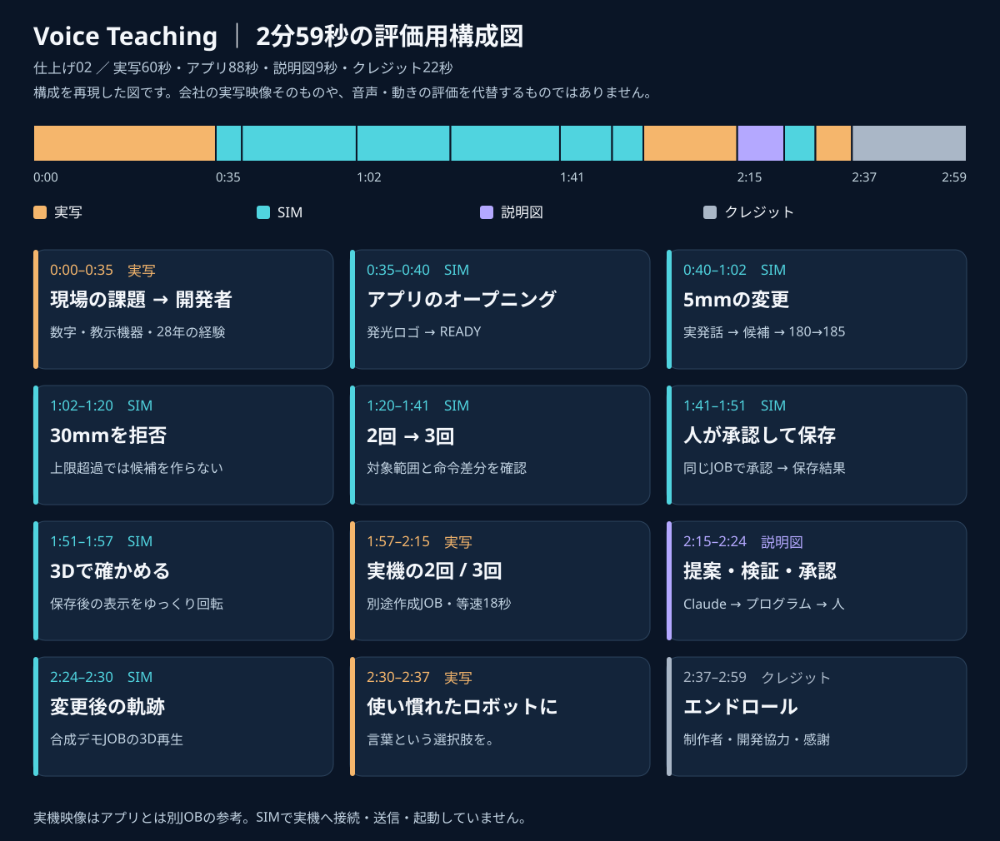
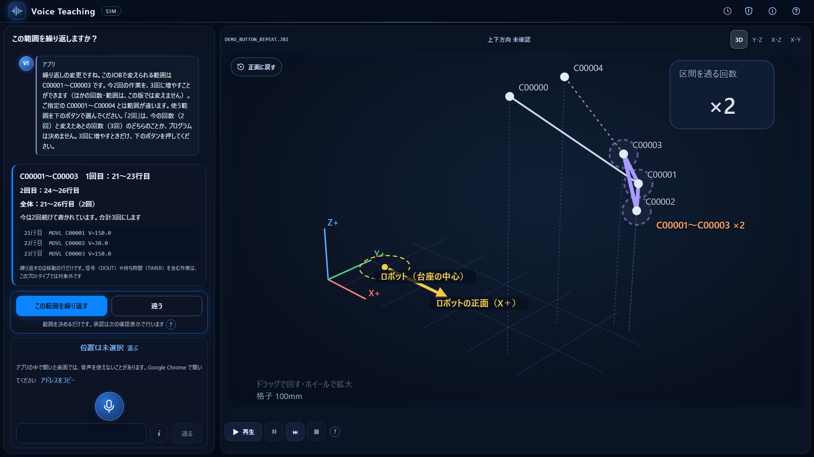
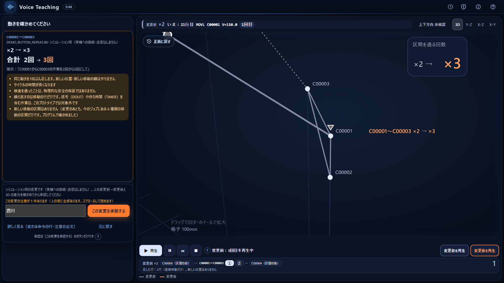
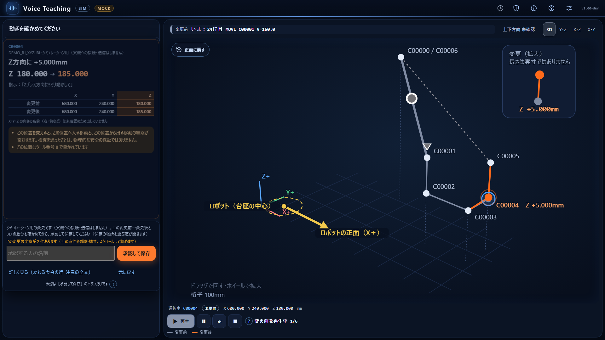

# クーちゃん評価の入口 — 仕上げ02

**仕上げ03の修正確認版を作成：[修正結果・最新時刻・採否待ちの項目](VT03_REVISION_REPORT_20261108.md)。179秒。クーちゃんの仕上げ02実映像レビューを受領し、E1〜E9・E11を反映。E10の音量上げは本人指定で見送り。最終採用は唐川さん待ち。**

このページの図・字幕・既存公開UI画像は仕上げ02の参考。仕上げ03の時刻と実施結果は上の修正記録・別添字幕を参照。動画・今回のコマは公開しない。

対象は **2分59秒の仕上げ02**。実写60秒、実録画の5mm変更・30mm拒否・2→3回・人の承認/保存・3D、アプリ本来のオープニング、22秒のエンドロールを含む。担当は最終編集・判断＝唐川、素材整理・編集支援＝チャッピーの分身、評価＝クーちゃん。

> 352c492の事前レビューは受領済み。ただし完成動画未視聴のレビューで、現行179秒版を評価した結果ではない。[朝の編集キット](MORNING_EDIT_KIT_20261108.md) と [前提の整合メモ](RECONCILIATION_KUU_352C492_AND_VT02_20261107.md) に現在地を反映した。

## 5分で確認する順番

1. 下の構成図で情報の順番と比率を見る。
2. [タイムラインと台本](TIMELINE_SCRIPT_20261107.md) と [音声時刻付きの字幕](CAPTIONS_JA_VT02_20261107.srt) を照合する。
3. 下の既存公開UI画像で、機能と配置を参考確認する。今回の収録フレームとは区別する。
4. [評価シートのひな形](REVIEW_KUU_RESPONSE_TEMPLATE_20261107.md) を使い、P0/P1を最大3件ずつに絞って提案する。

## この共有で見られるもの・まだ見られないもの

今回の動画から抜き出した静止画4枚は、動画と一緒に担当PCの非公開評価パックに保存した。GitHubへの新規画像公開は保留とし、下記の**既存公開RC画像**を参照する。画像は今回の動画フレームそのものではなく、字幕・トリミング・最新UI修正の完全一致を確認できるものでもない。

**このGitHub資料には動画本体・音声がない。** 音の聞き取りやすさ、実写の魅力、実時間でのテンポ、起動アニメーションの印象、クレジットのスクロール速度は「未評価」とする。台本と参考画像だけで動画を視聴したとは書かない。安全な動画共有先は唐川さんが確認後に決める。

## 既存の公開UI参考画像

### 繰り返す範囲の確認（RC基準）

対象範囲と変更内容の見せ方を確認する参考。今回の動画では1:20–1:41に実際の範囲確認と候補を入れている。

### 2回から3回の候補（RC基準）

追加命令と3Dの表示が初見で分かるかを参考確認する。実際の動画では見出し・SIM表記を加えているため、その見え方は動画共有後に確認する。

### 承認・保存の候補画面（RC基準）

注意と承認操作の配置を参考確認する。今回の動画は同じ繰り返しJOBで承認から保存結果まで接続している。

## 最優先の評価項目

| 観点 | この資料で答えられる問い | 動画を受け取るまで保留する問い |
|---|---|---|
| 最初10秒 | 508万台と現場課題の問いが伝わる構成か | 実写の迫力と最初10秒の聴感・テンポ |
| 初見の理解 | ティーチングの意味、誰の何の負担を減らすかが台本で分かるか | 実映像だけでも迷わないか |
| UI | 5mmの差分、30mmの拒否、2→3回、見出しが読めるか | 動作中に読み切れるか、ズームの切替 |
| 独自性 | 28年の現場経験とAIへの挑戦が伝わるか | 本人・実機カットの印象 |
| 責任の分担 | Claudeの提案・プログラム検証・人の承認を区別できるか | 説明と映像のタイミング |
| 誤認 | 実機は別JOB、アプリは合成JOBのSIMと台本で区別できるか | 切替の瞬間にも因果を誤認しないか |
| 最後の印象 | コピーと22秒のクレジットの配分は適切か | 締めの余韻、スクロール速度、音の終わり |

## 戻してほしいもの

`docs/video/REVIEW_KUU_20261107.md` などの別ファイルへ、確認した資料のコミットSHA、実際に見たもの、良い点、P0/P1/P2、タイムコード、具体的な変更、保留項目を書いてほしい。既存の制作報告を評価結果で上書きせず、見ていない観点に点数を付けない。

制作の根拠・素材の採否・未対応は [制作報告](REPORT_VIDEO_EDIT_20261107.md)、[素材一覧](MATERIALS_20261107.md)、[現状](STATUS_20261107.md)。正常なMP4は確保済み。Clipchamp編集コピーの読込み修復は残件にして、ここで作業を止めない。

動画の識別：`VoiceTeaching_仕上げ02_実写実演入り_2m59s.mp4`／179秒／SHA256 `0befc74085544b8e1b50bb535f4507f21c74645306bd74d3c6a063f52999cf32`。
